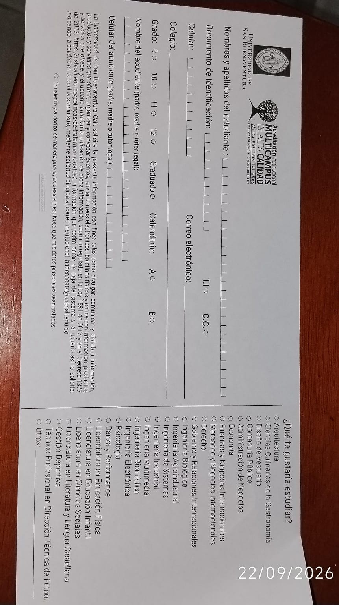

ERS

Especificación de Requisitos de Software

LexiGrid

Danna Isabella Ramos 
Juliana Hoyos Rueda 
Valeria Robles Torres

---

# **Índice de Contenidos**

- **1. Introducción**
  - 1.1 Propósito del Documento
  - 1.2 Alcance del Proyecto
    - 1.2.1 Alcance en el contexto de negocio
    - 1.2.2 Alcance en el contexto de uso
    - 1.2.3 Alcance en el contexto de desarrollo
    - 1.2.4 Alcance en el contexto de I.T
  - 1.3 Stakeholders del proyecto
    - 1.3.1 Equipo de desarrollo
  - 1.4 Definiciones, Acrónimos y Abreviaciones
  - 1.5 Referencias

- **2. Visión General del Producto**
  - 2.1 Perspectiva del Producto
  - 2.2 Funciones del Producto
  - 2.3 Restricciones del Producto
  - 2.4 Características del Usuario
  - 2.5 Supuestos y Dependencias

- **3. Técnicas de Elicitación**
  - 3.1 Entrevistas
    - 3.1.1 Entrevista 1: Administrador del sistema
    - 3.1.2 Entrevista 2: Embajadora
    - 3.1.3 Entrevista 3: Analista de mercadeo
  - 3.2 Prototipado
    - 3.2.1 Prototipo inicial
    - 3.2.2 Prueba del prototipo con usuarios
    - 3.2.3 Formulario de inscripción de referencia

- **4. Historias de Usuario**
  - 4.1 Historias de usuario
  - 4.2 División por sprints
    - 4.2.1 Validación con el cliente
      - 4.2.1.1 Objetivo y alcance
      - 4.2.1.2 Método de verificación: walk-through
      - 4.2.1.3 Participantes y distribución de las HU por rol
      - 4.2.1.4 Organización de las sesiones y criterios de clasificación
      - 4.2.1.5 Sesión 1: revisión inicial de todas las HU
      - 4.2.1.6 Sesión 2: pulido de detalles
      - 4.2.1.7 Sesión 3: validación final
      - 4.2.1.8 Resumen de resultados
  - 4.3 Definición de Terminado (Definition of Done)

- **5. Lecciones Aprendidas**

# **1. Introducción**

Esta sección presenta el propósito, el alcance y el contexto general del documento SRS para LexiGrid.

## **1.1 Propósito del Documento**

LexiGrid es una solución de dos componentes, una app móvil para los embajadores y una plataforma web para analistas de mercadeo y administradores, que digitaliza los formularios manuscritos de los aspirantes que el área de Mercadeo de la Universidad de San Buenaventura (USB) recoge en ferias universitarias y visitas a colegios.

El embajador fotografía cada formulario; un modelo de IA (OCR) extrae los datos y marca los campos que no logra leer con certeza; solo esos campos se revisan; los registros se organizan (duplicados, incontactables, prioridad) y se envían directamente a Salesforce

De esta forma, LexiGrid reduce el tiempo de digitación manual y facilita que los analistas prioricen el contacto con los aspirantes de mayor potencial.

## **1.2 Alcance del Proyecto**

El alcance de Lexigrid está dividido en los cuatro siguientes contextos:

### **1.2.1 Alcance en el contexto del negocio:**

El área de Mercadeo de la Universidad de San Buenaventura (USB) se encarga de la atracción, captación e ingesta de datos de aspirantes y futuros estudiantes matriculados; principalmente mediante la participación en ferias universitarias y visitas presenciales a colegios.

Actualmente, este proceso implica digitación manual y carga posterior al CRM Salesforce, lo que genera tiempos elevados, errores de transcripción y duplicidad de registros. LexiGrid busca optimizar este proceso mediante el uso de IA para el reconocimiento de letra manuscrita, reduciendo drásticamente los tiempos de procesamiento y mejorando la calidad de los datos capturados.

### **1.2.2 Alcance en el contexto del uso:**

- Perfil analítico (analista de mercadeo)

Rol: Utiliza la plataforma web para registrar colegios, crear y cerrar jornadas, revisar registros, depurar duplicados, preparar y enviar el lote a Salesforce, sacar reportes.

- Perfil operativo (embajadores): Iniciar sesión en la app móvil, elegir una jornada y sus respectivos colegios, poder subir los registros con o sin conexión, ver los estados de los registros, revisar los campos con la etiqueta de “por revisar”

- Perfil administrador: Usa la plataforma web para gestionar usuarios y permisos, parámetros, conexión y mapeo con Salesforce, dashboard, métricas, historial completo y supresión de dato

Flujo resumido:

1.  El analista registra los colegios y crea la jornada (feria o visita).

2.  El embajador inicia sesión, elige la jornada y el colegio activos y fotografía cada formulario; la app evalúa la calidad y guarda en una cola cifrada si no hay conexión.

3.  La foto se sube; la IA extrae los campos y marca como “Por revisar” los dudosos.

4.  Un analista (en la web) o el propio embajador confirma o corrige solo esos campos.

5.  La plataforma elimina duplicados, etiqueta incontactables, calcula la prioridad y excluye los registros sin autorización de datos.

6.  El analista revisa el resumen y envía el lote de la jornada a Salesforce; cada registro queda “Enviado” o “Error de envío”.

7.  El administrador supervisa métricas, seguridad y auditoría.

### **1.2.3 Alcance en el contexto del desarrollo:**

Software propuesto: sistema que digitaliza los formularios físicos de aspirantes, estructura y prioriza la información y la envía directo al CRM, sin pasar por Excel.

Componentes:

1.  App móvil (embajador): captura de fotos con evaluación de calidad en el dispositivo, modo offline con cola cifrada, y registro libre de jornada, colegio y ciudad.

2.  Plataforma web (analista y administrador): revisión en pantalla dividida, duplicados, papelera, prioridad y envío por jornada y colegio.

3.  Backend con IA/OCR: lectura de letra manuscrita y marcado de campos con certeza menor al 100 % como “Por revisar”.

4.  Integración directa con el CRM: envío registro por registro, con reintento y actualización.

5.  Almacenamiento seguro: imágenes cifradas y retención limitada.

Resultado esperado: menos digitación manual y menos errores. Cada

### **1.2.4 Alcance en el contexto de I.T:**

- **Despliegue:** backend contenerizado con Docker (API, modelo de IA y base de datos), en la red de la universidad o en un servicio cloud de bajo costo. La app móvil y la web consumen la misma API.

- **Backend:** Python (Flask o FastAPI) con el modelo de OCR/IA. La prioridad de los leads se calcula con reglas (grado, contacto y carrera), no con el modelo. Expone la integración con la API del CRM.

- **Base de datos:** PostgreSQL o MySQL, para la cola de procesamiento, los campos dudosos, la detección de duplicados y los estados de envío. Los casos dudosos permanecen ahí hasta que un **analista** los corrija en la web. Solo se envían los registros Verificados o Revisados.

- **Imágenes:** se conservan cifradas solo si hay campos por revisar, y se eliminan automáticamente un plazo después del envío. Viajan por TLS.

- **Seguridad y acceso:** roles fijos (embajador en app, analista y administrador en web), con bloqueo tras 3 intentos fallidos y cierre por inactividad. El embajador entra con un perfil general. La auditoría es inmutable y cumple Habeas Data, porque hay datos de menores de edad.

## **1.3 Stakeholders del proyecto:**

|   |   |
|---|---|
| **Project sponsor** | Área de mercadeo de la Universidad de San Buenaventura Cali |
| **Clientes** | Analistas, administrador y personal del área de mercadeo y embajadores |
| **Contractors** | Estudiantes de ingeniería de sistemas de la Universidad de San Buenaventura Cali |

## **1.4 Definiciones, Acrónimos y Abreviaciones**

| **Término** | **Definición**                                                                                                                        |
|-------------|---------------------------------------------------------------------------------------------------------------------------------------|
| SRS         | Documento de especificación de Requisitos de Software                                                                                 |
| USB         | Universidad de San Buenaventura                                                                                                       |
| OCR         | Reconocimiento Óptico de Caracteres                                                                                                   |
| CRM         | Customer Relationship Management                                                                                                      |
| I.T         | Information Technology                                                                                                                |
| Habeas Data | Derecho que tiene toda persona a conocer, actualizar, rectificar y suprimir la información que las organizaciones guardan sobre ella. |

## **1.5 Referencias**

- Prototipo:[https://uxpilot.ai/s/3b7b780cb3f410b8ea91f95f0009a2fc](https://uxpilot.ai/s/3b7b780cb3f410b8ea91f95f0009a2fc)

- Tablero trello: [https://trello.com/b/gC6IGO50/lexigrid](https://trello.com/b/gC6IGO50/lexigrid)

- Entrevistas: [https://drive.google.com/file/d/1I3Kr_vajBmk_emgBtmO8NubbiLqrlIru/view?usp=sharing](https://drive.google.com/file/d/1I3Kr_vajBmk_emgBtmO8NubbiLqrlIru/view?usp=sharing)

[https://drive.google.com/file/d/1HAYflZE3PSuhdEMJaAoeLudbZK69N5VH/view?usp=sharing](https://drive.google.com/file/d/1HAYflZE3PSuhdEMJaAoeLudbZK69N5VH/view?usp=sharing)
[https://drive.google.com/file/d/1iWT3Y6CxMyRxMOCUhvTGk7clwr0paMME/view?usp=sharing](https://drive.google.com/file/d/1iWT3Y6CxMyRxMOCUhvTGk7clwr0paMME/view?usp=sharing)

- Sala de planning poker (Kollabe): [https://kollabe.com/room?roomKey=7436e648543a42c28ed64ceb35c29d32](https://kollabe.com/room?roomKey=7436e648543a42c28ed64ceb35c29d32)

- Excel de las actividades para importar a Kollabe: [https://docs.google.com/spreadsheets/d/1KL2eUwqAYhNqTRMW-sAQNhqsxyZEo9jOFfZSeOxTPbE/edit?usp=sharing](https://docs.google.com/spreadsheets/d/1KL2eUwqAYhNqTRMW-sAQNhqsxyZEo9jOFfZSeOxTPbE/edit?usp=sharing)

- Excel con planning poker exportado: [https://docs.google.com/spreadsheets/d/1yZtlcy20R1-ZheS_5k78ZyZqZyWwKiGkUS8qq2SQdOI/edit?usp=sharing](https://docs.google.com/spreadsheets/d/1yZtlcy20R1-ZheS_5k78ZyZqZyWwKiGkUS8qq2SQdOI/edit?usp=sharing)

- Excel con planning poker organizado: [https://docs.google.com/spreadsheets/d/1N5fI3mFEnL-StLq16aFEX2XtjIW5PspW/edit?usp=sharing&ouid=103293696764452596241&rtpof=true&sd=true](https://docs.google.com/spreadsheets/d/1N5fI3mFEnL-StLq16aFEX2XtjIW5PspW/edit?usp=sharing&ouid=103293696764452596241&rtpof=true&sd=true)

# **2. Visión General del Producto**

## **2.1 Perspectiva del Producto**

El sistema es una aplicación móvil orientada a la digitalización y priorización de formularios de aspirantes captados por el área de mercadeo de la Universidad, en ferias y visitas a colegios. El producto reemplaza el proceso manual actual de transcripción en Excel, integrándose de forma directa con el CRM Salesforce que la Universidad ya utiliza para la gestión comercial

LexiGrid se compone de los siguientes módulos principales:

● **Módulo de autenticación:** gestiona el acceso seguro de usuarios
● **Módulo de escaneo:** permite fotografiar los formularios en físico
● **Módulo de transcripción:** procesa las imágenes capturadas mediante un modelo de inteligencia artificial para transcribir la información manuscrita y estimar el nivel de certeza de cada campo.
● **Módulo de revisión - corrección:** permite a los usuarios comparar la foto original con los campos transcritos y corregirlos manualmente
● **Módulo de priorización**: organiza los registros según la completitud de sus datos de contacto y grado escolar.
● **Módulo de detección de duplicados:** identifica y elimina aspirantes duplicados en base a su documento de identidad, guardando la información más completa.
● **Módulo de integración con Salesforce:** exporta de forma directa y automática los registros consolidados al CRM, sin pasos intermedios en Excel
● **Módulo de historial de cambios:** registra y almacena las acciones de cada usuario sobre el lote de registros.

## **2.2 Funciones del Producto**

El sistema incluye las siguientes funcionalidades principales:

● Autenticación de usuarios (inicio de sesión seguro)
● Captura de formularios físicos mediante fotografía desde dispositivo móvil
● Reconocimiento automático de escritura manuscrita mediante IA
● Validación de certeza en el escaneo de los registros sin interrumpir su carga.
● Revisión y comparación de campos dudosos
● Detección de aspirantes duplicados
● Priorización de los estudiantes según la completitud de su información
● Exportación directa de los registros con salesforce
● Trazabilidad de las acciones realizadas por los usuarios

## **2.3 Restricciones del Producto**

- El sistema depende de la disponibilidad y calidad de las fotografías tomadas por los embajadores.

- Se requiere conexión a internet para el funcionamiento de la aplicación y la sincronización con Salesforce.

- Solo usuarios registrados y autenticados con un perfil pueden acceder al sistema; no se permite el uso anónimo o compartido de cuentas.

- El sistema no debe exponer ni compartir información confidencial de los aspirantes fuera de los canales autorizados.

- El sistema no debe descartar aspirantes bajo ningún criterio automático.

- El sistema debe soportar el uso simultáneo de varios usuarios cargando información al mismo tiempo.

## **2.4 Características del Usuario**

El sistema contempla dos perfiles principales de usuario final:

- **Embajador:** encargado de la captura de formularios en campo mediante fotografía desde la aplicación móvil, y de la revisión y corrección de los campos marcados como dudosos por la IA. Es un usuario operativo, con acceso frecuente y simultáneo junto a otros embajadores durante eventos de alto volumen.

- **Analista:** encargado de la validación y corrección más detallada de los registros, así como de la resolución de casos de duplicados o inconsistencias que requieran mayor criterio. Su interacción con el sistema es más análitica.

## **2.5 Supuestos y Dependencias**

**Supuestos:**
- Los clientes cuentan con acceso a internet

- Los clientes cuentan con teléfonos móviles que cuentan con cámaras de buena resolución

- El equipo de mercadeo cuenta con acceso vigente y configurado a Salesforce.

- El sistema será utilizado principalmente durante eventos de captación (ferias, visitas a colegios) con volúmenes altos y simultáneos de carga.

**Dependencias:**
- Motor de base de datos relacional (PostgreSQL / MySQL) para la gestión de la cola de procesamiento y los casos dudosos.

- API de Salesforce para la integración y exportación directa de los registros.

- Modelo de inteligencia artificial de OCR para la transcripción de los formularios.

- Infraestructura de despliegue del backend mediante contenedores Docker, ya sea en la red local de la Universidad o en un servicio en la nube.

# **3. Técnicas de Elicitación**

Para levantar los requisitos de LexiGrid se emplearon dos técnicas de elicitación: **entrevistas** con los tres perfiles que intervienen en el proceso (administrador, embajador y analista de mercadeo) y **prototipado**, mediante un prototipo inicial que fue probado por una usuaria del área. Los hallazgos de ambas técnicas son la base de las historias de usuario de la sección 4.

## **3.1 Entrevistas**

Se realizaron tres entrevistas, una por perfil de usuario. Las grabaciones están disponibles en los enlaces indicados en cada entrevista y en la sección 1.5 Referencias.

| **Entrevista** | **Entrevistado(a)** | **Perfil** | **Enfoque** |
|---|---|---|---|
| 1 | Sebastián Cerezos | Administrador del sistema | Permisos, parámetros, conexión con Salesforce, métricas, seguridad y Habeas Data |
| 2 | Dana Isabela Ramos | Embajadora | Captura de formularios en campo y necesidades de la app móvil |
| 3 | Natalie Arce | Analista de mercadeo | Revisión, organización y envío de registros a Salesforce sin pasos manuales |

### **3.1.1 Entrevista 1: Administrador del sistema**

**Entrevistado:** Sebastián Cerezos, administrador del sistema (supervisión, configuración, seguridad y cumplimiento).

**Objetivo:** Definir permisos, parámetros, conexión con Salesforce, métricas y requisitos de seguridad y Habeas Data que debe cubrir la plataforma.

**Grabación:** [Entrevista del administrador](https://drive.google.com/file/d/1I3Kr_vajBmk_emgBtmO8NubbiLqrlIru/view?usp=sharing)

| **N.º** | **Pregunta** | **Respuesta** |
|---|---|---|
| 1 | En una jornada típica de ferias o visitas a colegios, ¿cuántos formularios físicos reciben aproximadamente? | Mínimo 200. |
| 2 | ¿Prefieren subir los formularios como fotos individuales tomadas con celular/tablet, o escanearlos en lote con un scanner físico? | Foto individual en el momento (celular/tablet). |
| 3 | Cuando el modelo de IA tenga dudas sobre un trazo manuscrito, ¿prefieren interrumpir la carga o dejarlo marcado como "por revisar"? | Seguir cargando sin detenerse: el campo queda marcado como "por revisar" y se corrige después. |
| 4 | ¿Cómo manejan la prioridad de contacto cuando un aspirante no tiene toda la información completa? | Priorizan por grado y por datos completos. |
| 5 | ¿Cuentan con una plantilla predefinida con encabezados y orden de columnas para la exportación posterior? | Se sube al CRM (Salesforce) con el formato del formulario para los aspirantes. |
| 6 | Al trabajar con Salesforce, ¿qué filtros o cruces de información usan con más frecuencia? | No es necesario (no manejan filtros ni cruces relevantes desde Salesforce). |
| 7 | Al exportar los datos priorizados, ¿necesitan un archivo consolidado o archivos separados por colegio/feria? | Un solo archivo consolidado. |
| 8 | Cuando un mismo aspirante queda registrado más de una vez, ¿qué debería pasar con esa información? | Eliminar el duplicado. |
| 9 | Si tuvieran que definir el éxito del proyecto en una sola métrica, ¿cuál sería? | Optimización de tiempo y reducción de errores manuales. |
| 10 | ¿Existen restricciones institucionales de seguridad o manejo de datos personales (Habeas Data) a considerar? | Evitar que la información o la base de datos se administre o comparta fuera de la institución. Debe existir una capa de seguridad con proceso de validación de acceso, perfiles específicos por usuario y trazabilidad (huella de auditoría) de quién manipula la data. |

**Información adicional obtenida:**

- Se solicitó explícitamente que LexiGrid funcione como un plugin o integración directa con Salesforce, exportando la información directamente al CRM sin pasos intermedios de descarga y carga manual.
- Para la captación de formularios se habló de una app móvil que permite tomar fotos de los formularios.
- Se reafirmó como una necesidad que varios usuarios puedan cargar al mismo tiempo.
- Salesforce es el sistema final de destino de los datos.

### **3.1.2 Entrevista 2: Embajadora**

**Entrevistada:** Dana Isabela Ramos, embajadora.

**Objetivo:** Entender cómo capturan hoy los formularios en campo, qué los frena y qué necesitan de la app móvil.

**Grabación:** [Entrevista del embajador](https://drive.google.com/file/d/1iWT3Y6CxMyRxMOCUhvTGk7clwr0paMME/view?usp=sharing)

| **N.º** | **Pregunta** | **Respuesta** |
|---|---|---|
| 1 | ¿Cómo recibes los formularios? | Los analistas de mercadeo entregan los formularios agrupados por feria o colegio, junto con los datos del colegio y un formulario escrito manualmente que debe transcribirse a Excel. |
| 2 | ¿Cómo organizas los formularios antes de digitarlos? | Prioriza los formularios con información más completa, ya que requieren más tiempo de transcripción. Deja para el final los que tienen datos faltantes, porque son más rápidos de procesar. |
| 3 | ¿Cómo subes actualmente la información al sistema? | Transcribe manualmente los datos en Excel utilizando la cuenta de correo de un analista. |
| 4 | ¿Qué parte del proceso te quita más tiempo? | Interpretar la letra de los estudiantes y transcribir números de identificación, teléfonos y correos electrónicos, debido a la dificultad para distinguir algunos caracteres. |
| 5 | ¿Qué errores suelen ocurrir al digitar la información? | Se pueden cometer errores al interpretar la letra o escribir los datos. Cuando la información es ilegible, debe intentar deducir lo que escribió el estudiante, lo que aumenta el riesgo de equivocaciones. |
| 6 | ¿Cuáles son los principales problemas con los formularios? | Muchos formularios tienen información incompleta: faltan nombres, colegios o datos de contacto. Algunos estudiantes seleccionan opciones de carreras muy diferentes entre sí o muestran poco interés y dejan campos sin diligenciar. |
| 7 | ¿Cómo te gustaría que funcionara una herramienta para fotografiar y registrar los formularios? | Le gustaría que la herramienta transcribiera automáticamente los datos, especialmente los numéricos, y permitiera revisar y confirmar manualmente la información que el sistema no pudiera reconocer con seguridad. |
| 8 | ¿Qué debería pasar si una fotografía sale borrosa o tiene poca luz? | El sistema debería identificar el problema, explicar por qué la imagen no es válida y permitir tomar otra fotografía inmediatamente. |
| 9 | ¿Cuándo prefieres saber que una fotografía no sirve? | En el momento de tomarla, mientras todavía tiene el formulario físico a la mano, para corregir el problema de inmediato. |
| 10 | ¿Cómo verificas actualmente que todos los formularios quedaron registrados? | Se guía por el orden de los formularios físicos y por las indicaciones de los analistas sobre cuáles ya fueron digitados. Sin embargo, la falta de un control claro ha ocasionado registros duplicados. |
| 11 | ¿Qué opinas de ingresar con el correo institucional y el código estudiantil? | Considera útil utilizar el correo institucional, pero prefiere que la contraseña pueda elegirse libremente y no tenga que ser exclusivamente el código estudiantil. |
| 12 | ¿Qué debería hacer la herramienta cuando no haya conexión a internet? | Debe permitir seguir tomando fotografías, conservar la información sin perderla y enviarla o sincronizarla automáticamente cuando se restablezca la conexión. |
| 13 | ¿Qué te preocupa de manejar los formularios desde un celular? | Le preocupa que la información personal pueda filtrarse o perderse, así como el cumplimiento de las normas de protección de datos, especialmente cuando se trata de menores de edad. |
| 14 | ¿Qué información necesitas cuando falla la carga de una fotografía? | Una notificación clara que indique que la carga falló y que es necesario intentar subir la fotografía nuevamente. |

**Principales necesidades identificadas:**

- **Automatización:** transcribir los datos de los formularios para reducir el trabajo manual.
- **Validación de datos:** permitir revisar y corregir los campos que el sistema no reconozca con certeza.
- **Control de calidad de imágenes:** detectar fotografías borrosas, oscuras o de baja calidad y solicitar que se repitan.
- **Prevención de duplicados:** llevar un registro claro de los formularios procesados y pendientes.
- **Funcionamiento sin conexión:** guardar temporalmente los datos y sincronizarlos al recuperar internet.
- **Seguridad y privacidad:** proteger la información personal y garantizar el cumplimiento de las normas de tratamiento de datos.
- **Notificaciones claras:** informar sobre errores de carga y ofrecer una acción para resolverlos.

### **3.1.3 Entrevista 3: Analista de mercadeo**

**Entrevistada:** Natalie Arce, analista de mercadeo que revisa, organiza y envía los registros.

**Objetivo:** Conocer cómo procesan hoy los formularios después de un evento y qué necesitan para revisar, organizar y enviar a Salesforce sin pasos manuales.

**Grabación:** [Entrevista del analista](https://drive.google.com/file/d/1HAYflZE3PSuhdEMJaAoeLudbZK69N5VH/view?usp=sharing)

**Preguntas realizadas:**

| **N.º** | **Pregunta** |
|---|---|
| 1 | Describe cómo procesas hoy los formularios después de un evento (digitación, Excel, correo, carga a Salesforce): ¿qué datos capturas y cuáles son los más difíciles de leer? |
| 2 | ¿Cuáles son los datos en los que más te demoras transcribiendo o en los que tengas que poner más cuidado? |
| 3 | ¿Qué reglas debe aplicar el sistema en algunos campos: por ejemplo, que los correos contengan? |
| 4 | ¿Les ha sucedido que escriben el nombre de los colegios de distintas formas? En caso de que sí, ¿cómo te gustaría que la página lo resuelva? |
| 5 | ¿Qué hacen cuando varios estudiantes marcan casillas diferentes en campos como el calendario del colegio al que asisten? ¿Les gustaría unos campos preestablecidos relacionados con los datos del colegio? |
| 6 | Cuando un dato queda dudoso (letra ilegible, dos casillas marcadas, celular incompleto, correo mal escrito), ¿cómo lo resuelves y qué necesitas tener a la vista para decidir? |
| 7 | ¿Cuándo confías en un dato extraído por la IA y qué casos dudosos esperas que el sistema detecte? |
| 8 | ¿Te gustaría que se manejen etiquetas como "por revisar" o "pendiente" cuando la IA no quede con el 100 % de certeza? |
| 9 | ¿Cómo te gustaría organizar la revisión hecha por la IA (por colegio, por jornada, pendientes) y qué pasa si dos personas corrigen el mismo formulario? |
| 10 | ¿Cómo detectas hoy a los aspirantes repetidos y qué criterio usas para decidir cuál registro se queda? Si se descarta uno por error, ¿cómo lo recuperarías? |
| 11 | ¿Y si el celular del aspirante y el del acudiente son iguales? |
| 12 | ¿Qué haces con los aspirantes que no dejaron celular ni correo? ¿Cómo debe tratarse al enviarlos a Salesforce? |
| 13 | ¿Con qué criterios decide el equipo comercial a quién llamar primero (grado, carrera, datos completos)? |
| 14 | ¿Cómo registras los colegios y organizas una feria o visita? ¿Los eventos tienen fecha? |
| 15 | Al enviar a Salesforce: ¿qué querrías ver antes de enviar, qué debería pasar si algunos registros fallan o Salesforce no responde, y cómo corregirías un dato que ya se envió? |
| 16 | Para ingresar a la plataforma usarías correo y contraseña: ¿qué debería pasar si olvidas la clave o dejas el computador abierto? |

## **3.2 Prototipado**

### **3.2.1 Prototipo inicial**

A partir de lo obtenido en las entrevistas se elaboró un **prototipo inicial** de LexiGrid, con el fin de validar con los usuarios las ideas de interfaz y de flujo antes de especificar las historias de usuario. Este prototipo es una primera versión y no representa el diseño final del sistema.

- Prototipo inicial: [https://uxpilot.ai/s/3b7b780cb3f410b8ea91f95f0009a2fc](https://uxpilot.ai/s/3b7b780cb3f410b8ea91f95f0009a2fc)

### **3.2.2 Prueba del prototipo con usuarios**

**Tester:** Yulieth Cardona, líder de los embajadores y analista.

**Observaciones para el perfil del embajador:**

- Tener presente que el perfil que usará el embajador en la app será uno brindado por Mercadeo y/o el de una persona de Mercadeo.
- Al tomar la foto, el embajador debe poder ver si fue procesada correctamente.
- Debe existir la opción de retomar la foto si el embajador no está segura de su calidad.
- Debe quedar claro si una foto marcada como dudosa por calidad debe repetirse en el momento o si se puede seguir subiendo y corregirla después.
- Debe poderse ver en algún lugar de la app cuántos formularios lleva cargados en la jornada.
- Se prefiere la vista dividida entre imagen y texto editable.

**Observaciones para el perfil del analista:**

- La exportación a Salesforce debe hacerse según la jornada o el evento.
- Debe poderse filtrar para no ver los aspirantes incontactables.
- Debe mostrarse una confirmación antes de enviar los registros a Salesforce, indicando cuántos se van a enviar.
- Debe poderse saber por qué un registro quedó eliminado como duplicado (qué datos coincidieron).
- El historial debe permitir buscar directamente por un aspirante, no solo por usuario.

### **3.2.3 Formulario de inscripción de referencia**

La siguiente imagen corresponde al formulario de inscripción que diligencian los aspirantes. Se usa como **referencia** para identificar los campos que el OCR debe extraer y las reglas de validación asociadas.

# **4. Historias de Usuario**

## **4.1 Historias de usuario**

Las historias de usuario de LexiGrid se organizan por épicas. Cada historia incluye su descripción (Como / Quiero / Para), sus criterios de aceptación y su prioridad según la técnica MoSCoW (Must, Should, Could, Won’t).

### **4.1.1 Épica \#1: Captura de datos**

#### **HU 1: Captura de formularios**

Como embajador

Quiero cargar fotos de los formularios de los aspirantes desde una aplicación móvil

Para evitar la digitalización manual de los colegios y ferias.

Criterios de aceptación:

- Se pueden tomar múltiples fotos de distintos formularios y cargarlas en una sola sesión de captura; cada foto corresponde a un formulario.

- Se puede tomar la foto directamente con la cámara integrada en la aplicación, sin tener que salir de la app.

- Después de tomar la foto y superar la evaluación de calidad, el sistema muestra una vista previa antes de confirmar la carga, permitiendo repetirla si no quedó conforme.

- Cada foto queda asociada al perfil general autenticado y a los datos del lote (evento, colegio y ciudad).

- Las fotos viajan cifradas desde la app hacia el servidor.

- Una vez completa la carga, las fotos no quedan almacenadas de forma visible o accesible en el dispositivo (ni en la galería).

- Solo los roles autorizados pueden visualizar las imágenes cargadas: el analista y el administrador, las de cualquier registro. El embajador no visualiza los formularios cargados; solo verifica que la carga fue exitosa mediante el estado de sincronización (HU 7) y el historial de cargas (HU 9).

- La conservación y eliminación de las imágenes en el servidor se rige exclusivamente por la HU 15.

MoSCoW: Must

#### **HU 2: Evaluar la calidad de la foto**

Como embajador

Quiero que al tomar la foto la app evalúe la calidad de la imagen en el propio dispositivo, antes de agregarla a la cola de carga

Para repetir la fotografía de inmediato si no es legible, incluso cuando no hay conexión a internet.

Criterios de aceptación:

- La evaluación de calidad se realiza en el dispositivo y funciona sin conexión a internet.

- Si la foto tiene baja calidad (borrosa, con poca luz, incompleta o con reflejos que impidan leer el texto), la app no la agrega a la cola de carga ni la envía al servidor.

- Si una foto tiene baja calidad, la app muestra una advertencia en pantalla antes de continuar.

- La advertencia debe indicar claramente el motivo del rechazo.

- La app debe ofrecer la opción de repetir la foto directamente desde la advertencia, sin tener que reiniciar todo el proceso de carga.

- Si la foto tiene buena calidad, la app continúa automáticamente con la vista previa y la confirmación de la carga.

- Superar la evaluación de calidad no garantiza que todos los campos sean legibles para la IA: los campos que el modelo no logre interpretar con certeza se marcan “Por revisar”.

MoSCoW: Should

#### **HU 3: Definir evento, colegio y ciudad del lote**

Como embajador

Quiero escribir el nombre del evento (feria o visita), el colegio y la ciudad del lote que voy a cargar

Para que cada formulario fotografiado quede asociado a su origen real sin depender de listas predefinidas.

Criterios de aceptación:

- Antes de la primera captura, la app solicita evento, colegio y ciudad como campos de texto obligatorios.

- La app no permite capturar formularios mientras falte alguno de los tres datos.

- Los valores se limpian automáticamente (espacios sobrantes al inicio, al final y duplicados); no se aceptan valores vacíos ni solo espacios.

- Cada formulario queda asociado a los tres valores vigentes en el momento de la captura.

- No se exige que el evento o el colegio existan previamente en el sistema.

- Los valores permanecen guardados al cerrar la app y se reutilizan hasta que el embajador los cambie.

- Todo el flujo funciona sin conexión; los datos viajan con los formularios al sincronizar.

MoSCoW: Must

#### **HU 4: Cambiar evento, colegio o ciudad fácilmente**

Como embajador

Quiero cambiar rápidamente cualquiera de los tres datos del lote

Para seguir cargando formularios cuando cambio de colegio o de evento sin interrumpir mi trabajo.

Criterios de aceptación:

- Los datos activos se muestran siempre visibles en la pantalla de captura.

- Se pueden editar en máximo 2 toques desde la pantalla de captura.

- Se puede cambiar un solo dato (por ejemplo, solo el colegio) conservando los otros dos.

- El cambio aplica solo a los formularios que se capturen después; los anteriores conservan sus valores.

- Mientras un formulario no se haya sincronizado, el embajador puede corregir sus datos de lote (por ejemplo, un error de digitación).

MoSCoW: Must

#### **HU 5: Sugerencias de valores usados anteriormente**

Como embajador

Quiero que la app me sugiera eventos, colegios y ciudades que ya escribí antes

Para evitar escribirlos de nuevo y reducir variantes del mismo nombre.

Criterios de aceptación:

- Al escribir en cada campo, la app muestra sugerencias de valores usados previamente en ese dispositivo.

- La coincidencia ignora mayúsculas y tildes.

- El embajador puede ignorar la sugerencia y escribir un valor nuevo.

- Las sugerencias funcionan sin conexión.

MoSCoW: Should

#### **HU 6: Modo offline**

Como embajador

Quiero que la app funcione en modo offline con una cola local de fotos pendientes

Para no perder trabajo por falta de conexión.

Criterios de aceptación:

- La app guarda las fotos tomadas localmente (de forma cifrada e inaccesible desde la galería) mientras no haya conexión.

- La evaluación de calidad, el registro de los datos del lote y la vista previa funcionan sin conexión.

- Al recuperar la conexión, la app las sube automáticamente, sin que el embajador tenga que hacer nada, siempre que exista una sesión activa; si la sesión expiró, la app solicita iniciar sesión y luego sube las fotos pendientes.

- La app le informa al embajador cuántas fotos están pendientes por cargar.

- La app muestra una confirmación cuando se suben las fotos pendientes correctamente.

- Una vez confirmada la subida de una foto, esta se elimina del dispositivo.

MoSCoW: Must

#### **HU 7: Estado de sincronización, fallos y reintento de cada foto**

Como embajador

Quiero ver el estado de sincronización de cada foto (Pendiente, Subiendo, Subida, Error) y recibir una notificación clara cuando una carga falla

Para saber si es necesario reintentar el proceso, sin perder las fotos tomadas localmente.

Criterios de aceptación:

- La app móvil muestra un indicador visual o etiqueta clara en cada foto tomada con su estado actual: Pendiente (en la cola local), Subiendo, Subida (recibida por el servidor) o Error.

- Si la foto falla en subirse (por pérdida de conexión, tiempo de espera agotado o error del servidor), la app cambia el estado a Error, muestra una alerta en pantalla con la causa específica del fallo (ej. “Sin conexión a internet”, “Error de respuesta del servidor”) y habilita la acción explícita “Reintentar”, que es la única acción de reintento manual de la app.

- Las fotos con estado Error permanecen almacenadas localmente en la cola offline hasta que el reintento sea exitoso.

- Al presionar “Reintentar” (desde la alerta o desde el listado), la app intenta subir únicamente las fotos con estado Error o Pendiente, sin duplicar las fotos con estado Subida; el servidor descarta cualquier reenvío de una foto ya recibida mediante su identificador único (HU 8).

- Al completarse la carga de todas las fotos asociadas a un evento y colegio, la app muestra una notificación general de éxito.

- La app actualiza el estado en tiempo real a medida que cada imagen completa su envío al servidor.

- El estado “Subida” indica únicamente que la foto llegó al servidor.

MoSCoW: Should

#### **HU 8: Carga simultánea**

Como embajador

Quiero escanear y cargar formularios al mismo tiempo que otros embajadores

Para agilizar lo máximo posible el proceso de escaneo.

Criterios de aceptación:

- Varios embajadores pueden asociar sus cargas a un mismo evento y a un mismo colegio, sin que el sistema les obligue a trabajar en sesiones separadas.

- El sistema no genera bloqueos de concurrencia al recibir imágenes de múltiples usuarios en paralelo.

- Cada foto obtiene un identificador único, generado en el dispositivo al capturarla y validado por el servidor, evitando que se sobrescriban o se mezclen registros y permitiendo descartar reenvíos de una misma foto.

- Si dos o más embajadores suben formularios al mismo tiempo para el mismo evento o colegio, el sistema los procesa de forma independiente.

- Cada registro conserva el perfil general y el dispositivo desde los que se capturó el formulario.

- El rendimiento de carga no debe degradarse significativamente cuando varios usuarios cargan al mismo tiempo, dentro de los volúmenes definidos para un evento típico.

MoSCoW: Must

#### **HU 9: Historial de cargas**

Como embajador

Quiero consultar un historial de los formularios y fotos que he cargado durante el evento

Para verificar que todo mi trabajo quedó registrado correctamente en la plataforma.

Criterios de aceptación:

- La app incluye una vista de “Historial de Cargas” que muestra el listado de formularios enviados por el embajador autenticado, sin mostrar los de otros embajadores.

- Cada ítem del historial detalla la hora de captura, el evento y el colegio indicados por el embajador y su estado actual: Subida (recibida por el servidor), En procesamiento, Verificado (la IA identificó todos los campos con certeza del 100%), Por revisar (tiene campos que requieren revisión manual), Revisado (todos sus campos por revisar ya fueron resueltos) o Error (la subida falló y se puede reintentar, HU 7).

- El historial muestra únicamente los estados de procesamiento del formulario. Los estados de duplicado y de papelera son internos del analista y no se muestran al embajador.

- El historial permite filtrar por evento y por colegio.

MoSCoW: Could

### **4.1.2 Épica \#2: Seguridad e inicio de sesión en la app móvil**

#### **HU 10: Inicio de sesión en la app móvil con perfil general**

Como embajador

Quiero iniciar sesión en la app móvil usando uno de los perfiles generales disponibles

Para poder cargar formularios sin necesitar una cuenta personal, mientras otros embajadores usan otros perfiles al mismo tiempo.

Criterios de aceptación:

- La app presenta una pantalla de inicio de sesión donde el embajador ingresa con un perfil general (por ejemplo, seleccionando el perfil e ingresando su clave).

- Solo pueden ingresar perfiles generales activos, creados por el administrador; el embajador no puede crear ni modificar perfiles desde la app.

- Si las credenciales son válidas, la app permite el acceso y asocia las cargas de la sesión al perfil autenticado y al dispositivo.

- Varios perfiles distintos pueden tener sesión activa al mismo tiempo en dispositivos diferentes sin interferir entre sí.

- Un perfil no puede tener sesión activa en dos dispositivos a la vez; si se intenta, la app informa que el perfil está en uso y no permite el ingreso.

- Al cerrar sesión, el perfil queda libre para que otro embajador lo use.

- Si un perfil quedó ocupado por un dispositivo perdido o sin conexión, el administrador puede liberarlo (HU 41).

- Bloqueo de seguridad: tras 3 intentos fallidos consecutivos sobre un perfil, el sistema lo bloquea temporalmente por 10 minutos e informa el tiempo de espera.

- Protección de rutas: toda función de la app (captura, cola offline, historial) requiere sesión activa; sin sesión, redirige al login.

- La clave del perfil se oculta al digitarse y se almacena cifrada.

- La sesión se mantiene en el dispositivo aunque se pierda la conexión, mientras el token local siga vigente; el primer inicio de sesión en un dispositivo requiere conexión.

MoSCoW: Must

#### **HU 11: Cierre de sesión automático en la app móvil**

Como embajador

Quiero que la aplicación cierre mi sesión automáticamente tras un periodo de inactividad o permitirme cerrarla manualmente

Para proteger los datos recolectados y prevenir accesos no autorizados en caso de pérdida o robo del dispositivo móvil.

Criterios de aceptación:

- La app detecta la inactividad del usuario (sin toques en pantalla ni capturas en segundo plano) y cierra la sesión automáticamente tras un tiempo límite configurable (ej. 15 minutos).

- Ante un cierre por inactividad, la app elimina el token de acceso activo y redirige inmediatamente a la pantalla de login solicitando credenciales nuevamente.

- Si no hay conexión al volver a iniciar sesión, la app valida el perfil y la clave contra una huella cifrada de las credenciales guardada en el dispositivo, mientras no haya vencido la vigencia offline; así el embajador puede continuar su trabajo sin señal.

- La interfaz incluye una opción o botón explícito de “Cerrar sesión” accesible en todo momento desde el perfil o menú principal.

- Al cerrar sesión manualmente o por inactividad, las fotos de la cola local pendientes de envío se mantienen resguardadas de forma cifrada e inaccesibles desde la galería del dispositivo, y se suben cuando el mismo perfil general inicie sesión y haya conexión.

- Si venció la vigencia offline y no hay conexión, la app no permite iniciar sesión hasta recuperar la conexión; las fotos pendientes permanecen cifradas.

MoSCoW: Should

### **4.1.3 Épica \#3: Procesamiento del reconocimiento óptico de caracteres (OCR)**

#### **HU 12: Identificación de campos**

Como analista de mercadeo

Quiero que la plataforma web identifique automáticamente los campos legibles de cada formulario mediante OCR

Para hacer más eficiente el proceso de transcripción y reducir la digitación manual.

Criterios de aceptación:

- El sistema identifica y extrae el nombre y apellidos del aspirante (campo de texto libre).

- El sistema identifica y extrae el número de documento de identificación del aspirante (campo de texto libre).

- El sistema identifica y extrae el número de celular del aspirante y, si existe, el del acudiente (campos de texto libre).

- El sistema identifica y extrae el correo electrónico del aspirante y el nombre del acudiente (campos de texto libre).

- El sistema identifica el tipo de documento (T.I. o C.C.), el grado (9, 10, 11, 12 o graduado), el tipo de calendario (A o B), la o las carreras de interés marcadas y la autorización de tratamiento de datos personales (campos de opción múltiple o de marca).

- Cada campo identificado queda asociado correctamente a su etiqueta dentro del registro y es visible en la plataforma web apenas termina el procesamiento, junto con su estado (definido en la HU 13).

MoSCoW: Must

#### **HU 13: Campos con incertidumbre**

Como analista de mercadeo

Quiero que el sistema procese de forma continua los formularios y marque los campos donde el modelo de IA no logre interpretar con certeza (por ejemplo, por letra manuscrita ilegible)

Para que un analista los verifique o modifique manualmente antes de enviar el lote al CRM.

Criterios de aceptación:

- Un campo se marca “Verificado” cuando la IA lo identifica con un nivel de certeza del 100%; cualquier campo con certeza inferior al 100% se marca “Por revisar”. El umbral del 100% es fijo y no es configurable.

- Un campo que viene en blanco en el formulario físico y que la IA identifica como vacío con certeza se registra como vacío y “Verificado”; no se marca “Por revisar”.

- Si el OCR no logra identificar con certeza el valor de un campo de texto libre, el campo queda marcado como “Por revisar”.

- En campos de opción múltiple, si existe ambigüedad (ej. dos casillas marcadas o ninguna marcada cuando debería haber una), el sistema marca el campo como “Por revisar”.

- El estado “Por revisar” queda asociado solo al campo dudoso, no al formulario completo; el campo se resalta en color amarillo en la plataforma web.

- El registro queda “Verificado” cuando todos sus campos están “Verificados” y “Por revisar” cuando al menos un campo lo está.

- La conservación o eliminación de la imagen según este resultado se rige por la HU 15.

- El procesamiento no se detiene cuando encuentra un campo dudoso; continúa con el resto del formulario y los siguientes sin interrupción.

MoSCoW: Must

#### **HU 14: Validación de formato de los datos extraídos**

Como analista de mercadeo

Quiero que la plataforma valide el formato de los datos extraídos (documento, celulares y correo electrónico)

Para evitar que lleguen al CRM datos de contacto o de identificación con formato inválido.

Criterios de aceptación:

- El sistema valida que el número de documento contenga solo dígitos, que cada celular tenga un formato válido de 10 dígitos y que el correo electrónico tenga una estructura válida (usuario@dominio).

- Si un valor no cumple el formato, el campo se marca “Por revisar” indicando el motivo (ej. “formato de correo inválido”) para que el revisor lo corrija; el valor no se descarta.

- El sistema no permite guardar como “Revisado manualmente” un celular, un correo o un documento con formato inválido: el revisor debe corregirlo o dejarlo vacío.

- Para efectos de contacto y priorización, un dato se considera válido cuando está presente y cumple el formato.

- Si dentro de un mismo registro el celular del aspirante y el del acudiente son iguales, el sistema conserva un solo número como celular principal y deja vacío el del acudiente.

MoSCoW: Must

#### **HU 15: Almacenamiento selectivo y retención de imágenes**

Como administrador del sistema

Quiero que la plataforma conserve las imágenes solo mientras sean necesarias para la revisión y la auditoría, y las elimine después

Para optimizar el almacenamiento y limitar el tiempo que se conservan los documentos originales de los aspirantes.

Criterios de aceptación:

- Si tras el procesamiento todos los campos del registro son “Verificados”, el sistema elimina la imagen del servidor automáticamente y no conserva ninguna copia.

- Si el registro tiene al menos un campo “Por revisar”, el sistema conserva la imagen cifrada y asociada al registro; mientras haya campos “Por revisar”, la imagen no se elimina.

- Una vez que el registro queda “Enviado” al CRM, la imagen se conserva durante un plazo configurable (por ejemplo, 10 días) y luego se elimina automáticamente.

- Un registro “Revisado” que aún no ha sido enviado conserva su imagen de forma indefinida: el plazo de retención corre solo desde el envío.

- Si el registro ya fue enviado y su imagen ya fue eliminada, el registro permanece completo; solo se pierde la imagen.

- La imagen de un registro en la Papelera se elimina junto con el registro al cumplirse sus 30 días (HU 24).

- El administrador puede consultar y modificar el plazo de retención; el cambio aplica a los envíos futuros.

- Cada eliminación de imagen queda registrada en el historial de auditoría, sin contener datos personales del aspirante.

- Esta es la única HU que define las reglas de conservación y eliminación de imágenes; las demás la referencian.

MoSCoW: Must

### **4.1.4 Épica \#4: Revisión manual de transcripciones**

#### **HU 16: Interfaz de comparación en la plataforma web**

Como analista de mercadeo

Quiero visualizar en pantalla dividida, desde la plataforma web, la imagen del formulario físico frente a los datos extraídos por la IA

Para verificar o corregir manualmente los campos marcados como “Por revisar” antes de enviar el lote al CRM.

Criterios de aceptación:

- Mientras el registro tenga campos “Por revisar”, la imagen original está disponible para revisarse en cualquier momento, no solo al final de la sesión de escaneo (conservación según HU 15).

- El analista accede a la imagen original desde el campo marcado como “Por revisar”, visualizándola en pantalla dividida junto al valor extraído por la IA.

- El sistema permite sobrescribir el campo (editar manualmente el valor) o confirmar el texto ya identificado por la IA, sin necesidad de transcribir el formulario completo.

- Al confirmar o corregir un campo, el sistema lo marca como “Revisado manualmente” y actualiza su resaltado a color verde, reemplazando el amarillo de “Por revisar”.

- Cuando ya no queda ningún campo “Por revisar”, el registro pasa a estado “Revisado” y queda listo para envío al CRM.

- Cada confirmación o corrección queda registrada en el historial con el usuario, el valor anterior y el valor nuevo.

- Los registros “Enviados” se muestran en solo lectura y no admiten confirmación ni corrección (HU 28).

MoSCoW: Must

#### **HU 17: Prevención de ediciones simultáneas sobre un registro**

Como analista de mercadeo

Quiero que el sistema impida que dos analistas modifiquen al mismo tiempo el mismo registro

Para evitar que una corrección sobreescriba a otra.

Criterios de aceptación:

- Cuando un analista abre un registro en la plataforma web para revisarlo o corregirlo, el registro queda marcado como “en revisión” por ese analista.

- Mientras esté “en revisión”, los demás analistas pueden consultarlo en solo lectura pero no editarlo. La web indica quién lo tiene abierto y desde cuándo.

- La marca aplica a cualquier registro abierto para edición en la web, incluidos los de la papelera y los que están en resolución de duplicados.

- La marca se libera al guardar los cambios, al cerrar el registro o tras un tiempo de inactividad configurable. Si el analista cierra sesión o pierde la conexión, se libera por inactividad.

- El sistema rechaza el guardado de quien no tenga la marca, aunque la interfaz esté desactualizada.

- El bloqueo de edición no impide la carga de nuevas fotos desde la app ni el procesamiento de los formularios (OCR).

MoSCoW: Should

#### **HU 18: Ver campos pendientes por registro y filtrar por embajador**

Como analista de mercadeo

Quiero ver cuántos campos “Por revisar” tiene cada registro y filtrar los registros por el perfil general (embajador) que los capturó

Para organizar mi cola de trabajo sin tener que recorrer todos los registros del evento.

Criterios de aceptación:

- El filtro por estado “Por revisar” (HU 29) muestra únicamente los registros con al menos un campo “Por revisar”, e indica cuántos campos pendientes tiene cada registro listado.

- El analista puede filtrar además por el perfil general (embajador) que capturó el formulario y combinarlo con el evento y el colegio (HU 29).

MoSCoW: Should

#### **HU 19: Comentarios internos en un registro dudoso**

Como analista de mercadeo

Quiero dejar una nota interna sobre un registro que me generó dudas al corregirlo

Para que otro analista que revise el mismo caso más adelante tenga el contexto necesario.

Criterios de aceptación:

- El sistema permite agregar una nota de texto libre a cualquier registro desde su vista de detalle.

- Cada nota queda asociada al usuario que la escribió y a la fecha y hora en que se registró.

- Las notas son visibles para cualquier analista o administrador que abra ese registro, pero no son visibles en la app móvil.

- Las notas son de uso interno de LexiGrid: nunca forman parte de los datos que se envían al CRM.

MoSCoW: Could

#### **HU 20: Visualización de la imagen original desde un registro**

Como analista de mercadeo

Quiero acceder a la imagen original de un formulario desde el detalle del registro, incluso si ya quedó “Revisado” o “Enviado”

Para poder auditar o resolver dudas posteriores sin depender del flujo inicial de revisión.

Criterios de aceptación:

- El sistema permite abrir la imagen original desde el detalle del registro en cualquier momento mientras esta se conserve, no solo mientras el campo está “Por revisar”.

- Si el registro quedó “Verificado” desde el procesamiento, no existe imagen; el detalle lo indica claramente (“Imagen no conservada: todos los campos fueron identificados con certeza del 100%”).

- Si la imagen ya fue eliminada por cumplirse el plazo de retención, el detalle lo indica.

- La imagen se muestra en la misma vista de comparación usada durante la revisión inicial.

MoSCoW: Could

### **4.1.5 Épica \#5: Organización de registros**

#### **HU 21: Detección de duplicados y estado “Por revisar duplicado”**

Como analista de mercadeo

Quiero que la plataforma web detecte a los aspirantes duplicados y los deje en estado “Por revisar duplicado” sin descartar ni modificar nada

Para mantener el control de lo que se carga al CRM.

Criterios de aceptación:

- El sistema identifica duplicados cuando coincide el número de documento o el correo electrónico entre dos o más registros de LexiGrid, del mismo evento o de otros, incluidos los ya enviados al CRM.

- La coincidencia de celular no se considera duplicado, porque varios aspirantes pueden compartir el celular de un mismo acudiente.

- La comparación solo usa campos que no estén “Por revisar”; cuando un campo se resuelve, el sistema reevalúa los duplicados.

- Al detectar una coincidencia, el registro de captura más reciente (“nuevo”) pasa a “Por revisar duplicado”; el registro de captura más antigua (“anterior”) conserva su estado. Nada se descarta ni se sobrescribe automáticamente.

- Si un registro coincide con varios (por ejemplo, con B por documento y con C por correo), todos se agrupan en un mismo caso que el analista resuelve en conjunto.

- “Por revisar duplicado” es un estado del registro, independiente del “Por revisar” de los campos: un registro puede estar “Verificado” por el OCR y aun así estar en “Por revisar duplicado”.

- Este estado y el apartado de duplicados son exclusivos del analista en la plataforma web; no se muestran en la app móvil.

- La detección queda registrada en el historial de auditoría.

- La deduplicación se hace solo dentro de LexiGrid; la plataforma no consulta registros del CRM.

MoSCoW: Must

#### **HU 22: Resolver duplicados desde el apartado Duplicados**

Como analista de mercadeo

Quiero ver qué información difiere entre los registros duplicados y decidir cuál conservar

Para tener el control de lo que se carga al CRM.

Criterios de aceptación:

- La plataforma web tiene un apartado “Duplicados”, exclusivo del analista, con los casos en “Por revisar duplicado”.

- Para cada caso muestra los registros coincidentes, por qué campo coincidieron (documento o correo) y qué campos difieren (valor anterior y valor nuevo).

- El analista puede resolver el caso de tres formas: conservar el registro anterior, conservar el nuevo, o elegir campo por campo qué valor queda.

- El sistema sugiere como opción por defecto la información más reciente, pero nada se aplica hasta que el analista la confirme.

- Al resolver, queda un único registro con los valores elegidos, sale de “Por revisar duplicado” y continúa su flujo normal. El registro que no se conserva pasa a la Papelera con el motivo “Duplicado descartado” (HU 24).

- Un registro ya “Enviado” nunca se modifica automáticamente: si el analista conserva información nueva, el registro enviado queda “Pendiente de actualización”. El envío de esa actualización corresponde a la HU 39.

- La decisión del analista (qué valores conservó) queda en el historial de auditoría.

MoSCoW: Must

#### **HU 23: Clasificación de aspirantes incontactables**

Como analista de mercadeo

Quiero que la plataforma retire de la fila de trabajo los registros que no tienen ningún canal de contacto y los mande a la papelera

Para que mi cola solo tenga aspirantes que el equipo comercial puede contactar.

Criterios de aceptación:

- Si un registro no tiene celular del aspirante, celular del acudiente ni correo, el sistema lo quita de la fila (por revisar y listos) y lo mueve a la papelera.

- Si el registro tiene al menos uno de los tres datos de contacto, permanece en la fila.

- Si alguno de los tres campos de contacto está en estado “Por revisar”, el registro no se mueve hasta que ese campo se resuelva. Cuando se resuelve y sigue sin ningún canal, se mueve.

- El sistema reevalúa esta regla cada vez que cambia alguno de los tres datos de contacto.

- Al moverse, el registro guarda la fecha de eliminación y el motivo “Incontactable (sin canal de contacto)”.

- Los registros en la Papelera no se incluyen en los conteos de la fila.

- Cada movimiento queda en el historial de acciones, indicando que fue una acción automática del sistema.

MoSCoW: Should

#### **HU 24: Papelera de registros descartados**

Como analista de mercadeo

Quiero consultar y restaurar los registros que el sistema sacó de la fila (“Duplicado descartado” e “Incontactable”) durante 30 días

Para corregir errores del sistema sin perder aspirantes y sin conservar datos personales más tiempo del necesario.

Criterios de aceptación:

- Los registros descartados por “Duplicado descartado” o por “Incontactable (sin canal de contacto)” se guardan en una sección “Papelera” durante 30 días.

- Cada registro muestra su motivo, la fecha de eliminación y los días restantes. Si es un duplicado, también indica con qué registro coincidió y por qué campo.

- El analista puede restaurar un registro. No se descarta de nuevo automáticamente por la misma causa mientras no cambie su información.

- Un registro restaurado con motivo “Duplicado descartado” queda en “Por revisar duplicado” si no tiene campos “Por revisar”; si tiene algún campo “Por revisar”, queda en “Por revisar”. Un registro restaurado con motivo “Incontactable” vuelve a la fila con el estado que le corresponde por sus campos.

- Cada restauración queda en el historial con el usuario, la fecha y el motivo original.

- Los registros en la Papelera no cuentan en la fila.

- Al cumplirse los 30 días, el sistema elimina definitivamente el registro y su imagen, y registra solo el identificador y la fecha de la purga.

MoSCoW: Must

#### **HU 25: Filtrar y restaurar en lote la Papelera**

Como analista de mercadeo

Quiero filtrar la Papelera por motivo y por colegio y restaurar varios registros a la vez

Para encontrar rápido los registros a recuperar y corregir errores del sistema en bloque.

Criterios de aceptación:

- La Papelera se puede filtrar por motivo y por colegio.

- El analista puede restaurar varios registros a la vez; cada uno sigue las reglas de restauración de la HU 24.

MoSCoW: Should

#### **HU 26: Recuperación automática de incontactables al corregir su contacto**

Como analista de mercadeo

Quiero que un registro que está en la papelera por ser incontactable vuelva solo a la fila de trabajo cuando corrijo alguno de sus datos de contacto en la plataforma web

Para no perder aspirantes recuperables sin tener que buscarlos y restaurarlos manualmente.

Criterios de aceptación:

- El sistema reevalúa el registro cada vez que el analista edita un dato de contacto (celular del aspirante, celular del acudiente o correo) en la plataforma web.

- El analista puede editar los datos de contacto de un registro desde la Papelera (movido desde la HU 22).

- Si el registro está en la papelera con motivo “Incontactable” y tras la edición tiene al menos un canal de contacto, el sistema lo saca de la papelera y lo devuelve a la fila de trabajo sin acción adicional.

- Al volver a la fila, el sistema le asigna su prioridad según las reglas vigentes. Si tiene campos “Por revisar”, entra a esa cola.

- Si tras la edición sigue sin ningún canal de contacto, permanece en la papelera y su plazo de 30 días no se reinicia.

- Un registro cuyo plazo de 30 días ya venció y fue eliminado definitivamente no se puede recuperar.

- Un registro con motivo “Duplicado descartado” no se recupera automáticamente al editarlo; solo se puede restaurar manualmente (HU 24).

- Si el registro ya había sido enviado al CRM y se edita su dato de contacto, queda como “Pendiente de actualización”.

- La recuperación automática queda en el historial, con el analista que hizo la corrección y la fecha.

MoSCoW: Should

#### **HU 27: Priorización de leads**

Como analista de mercadeo

Quiero que la plataforma priorice automáticamente a los aspirantes según su grado, su carrera de interés y la completitud de sus datos de contacto

Para facilitar la gestión comercial, dando prioridad a estudiantes de grado 11 o graduados con datos de contacto válidos.

Criterios de aceptación:

- Contacto completo: al menos un celular válido (del aspirante o del acudiente) y un correo electrónico válido. Contacto parcial: solo celular o solo correo. Carrera definida: al menos una carrera de interés marcada, sin ambigüedad.

- Prioridad Alta: grado 11 o graduado, con contacto completo y carrera definida.

- Prioridad Media: grado 11 o graduado con contacto parcial o sin carrera definida; o grado 9, 10 o 12 con contacto completo.

- Prioridad Baja: grado 9, 10 o 12 con contacto parcial.

- Si el grado está en blanco y “Verificado”, el registro tiene prioridad Baja.

- Dentro de cada nivel, el sistema ordena primero los registros con más campos diligenciados y, en caso de empate, los capturados más recientemente.

- Los aspirantes “Incontactables” no aparecen porque están en la Papelera.

- Si el grado, un dato de contacto o la carrera están “Por revisar”, el registro queda como “Pendiente de prioridad” hasta que se resuelvan; el sistema recalcula la prioridad cada vez que cambia alguno de esos datos.

- La prioridad se aplica de forma consistente en todas las listas y se envía al CRM como un campo del mapeo (HU 33).

MoSCoW: Should

#### **HU 28: Conservar registros enviados en un archivo aparte**

Como analista de mercadeo

Quiero que los aspirantes ya enviados al CRM permanezcan guardados en la plataforma, separados de los que están en trabajo

Para conservar el respaldo de lo enviado sin que estorbe en la revisión diaria.

Criterios de aceptación:

- Los registros “Enviados” no se eliminan ni se anonimizan por el paso del tiempo.

- Los registros enviados no aparecen en las vistas de trabajo (por revisar, listos, incontactables) ni en los conteos de pendientes.

- Existe una sección o filtro de “Enviados” donde el analista puede consultarlos por evento, colegio y ciudad (reutiliza los filtros de la HU 29).

- Los registros enviados siguen participando en la detección de duplicados: si llega un aspirante nuevo igual a uno ya enviado, el sistema lo señala.

- Los registros enviados son de solo lectura; los únicos cambios posibles ocurren por la resolución de duplicados (HU 22) o la edición de contacto (HU 26) y los dejan “Pendiente de actualización”.

- Un registro enviado conserva todos sus datos, el estado y la fecha de envío, aunque su imagen haya sido eliminada.

MoSCoW: Must

### **4.1.6 Épica \#6: Eventos e integración directa con el CRM**

#### **HU 29: Filtrar aspirantes por evento, colegio y ciudad**

Como analista de mercadeo

Quiero filtrar los aspirantes por evento, colegio y ciudad

Para revisar y exportar la información de un evento o colegio específico sin buscar manualmente.

Criterios de aceptación:

- La plataforma ofrece filtros por evento, colegio y ciudad, combinables entre sí y con el estado (por revisar, verificados, revisados, duplicados).

- Las opciones de cada filtro se generan a partir de los valores existentes en los formularios cargados.

- Cada filtro permite búsqueda por texto parcial, ignorando mayúsculas y tildes.

- Los filtros se mantienen al navegar entre vistas y se pueden limpiar con una sola acción.

- La vista muestra el total de resultados del filtro aplicado.

MoSCoW: Must

#### **HU 30: Ver avance de revisión y de envío por evento y colegio**

Como analista de mercadeo

Quiero ver un resumen de cuántos aspirantes hay en cada estado por evento y colegio

Para saber qué falta por revisar antes de exportar al CRM.

Criterios de aceptación:

- La plataforma muestra una tabla agrupada por evento y colegio con la cantidad de aspirantes en cada estado de revisión.

- La tabla muestra también la cantidad de registros en cada estado de envío (Pendiente de envío, Enviado, Error de envío, Pendiente de actualización).

- Se puede ordenar por cantidad de “Por revisar”.

- Al seleccionar una fila, se aplica automáticamente el filtro de evento y colegio correspondiente (HU 29).

- Los conteos se actualizan al cambiar el estado de un aspirante.

MoSCoW: Should

#### **HU 31: Unificar variantes de nombre de colegio, evento o ciudad**

Como analista de mercadeo

Quiero unificar variantes escritas distinto del mismo colegio, evento o ciudad

Para que los filtros y reportes no queden fragmentados.

Criterios de aceptación:

- El sistema sugiere valores similares entre sí (por ejemplo, “Col. San José” y “Colegio San Jose”).

- El analista puede seleccionar dos o más variantes y elegir el valor final.

- La unificación actualiza todos los registros afectados.

- La unificación queda registrada en el historial de auditoría.

- No modifica registros ya enviados al CRM (son de solo lectura, HU 28).

MoSCoW: Could

#### **HU 32: Configuración de la conexión con el CRM**

Como administrador del sistema

Quiero configurar y autorizar la conexión entre LexiGrid y el CRM

Para que la plataforma envíe los registros directamente al CRM, sin intervención manual de archivos.

Criterios de aceptación:

- El administrador registra los datos de conexión (organización y credenciales o autorización de acceso) y selecciona el ambiente de destino (pruebas o producción).

- La plataforma incluye la acción “Probar conexión”, que informa claramente si la conexión es exitosa o la causa del fallo.

- Las credenciales se almacenan cifradas y no se muestran una vez guardadas.

- La plataforma muestra el estado de la conexión (Conectado o Con error) y la fecha de la última verificación.

- Mientras no exista una conexión configurada y vigente, el envío al CRM permanece deshabilitado y la plataforma lo indica.

- Toda modificación de la configuración queda registrada en el historial de auditoría.

MoSCoW: Must

#### **HU 33: Mapeo de campos hacia el CRM**

Como administrador del sistema

Quiero definir la correspondencia entre los campos de LexiGrid y los campos del objeto del CRM

Para que cada dato llegue al campo correcto del CRM sin transformaciones manuales.

Criterios de aceptación:

- El administrador define el mapeo de, como mínimo, los siguientes datos: nombre y apellidos, tipo y número de documento, celular del aspirante, celular del acudiente, correo electrónico, nombre del acudiente, grado, calendario, carreras de interés, evento de origen, colegio, ciudad y prioridad (cuando esté disponible, HU 27).

- Para los campos de opción múltiple, el administrador define la equivalencia entre los valores de LexiGrid y los valores aceptados por el CRM.

- Para cada campo requerido por el CRM, el administrador define qué hacer si queda vacío (dejarlo en blanco o enviar un valor por defecto), de modo que el envío no falle ni se corrompa.

- Las notas internas, las imágenes y los datos de auditoría no forman parte del mapeo y nunca se envían al CRM.

- La plataforma valida el mapeo contra los campos disponibles en el CRM y alerta si algún campo mapeado no existe.

- Los cambios de mapeo aplican a los envíos futuros, no modifican los registros ya enviados y quedan registrados en el historial de auditoría.

MoSCoW: Must

#### **HU 34: Preparar el lote por evento y colegio y ver su resumen**

Como analista de mercadeo

Quiero preparar el lote de envío de un evento y un colegio y ver un resumen de su contenido antes de enviarlo al CRM

Para transmitir la información validada sin manipular archivos individuales.

Criterios de aceptación:

- El analista selecciona un evento y un colegio (valores existentes en los formularios) para preparar el lote, y puede seleccionar explícitamente varios eventos para enviarlos juntos.

- Un registro está listo para envío cuando es “Verificado” o “Revisado”, cuenta con autorización de tratamiento de datos, no está en la Papelera y no está en “Por revisar duplicado”.

- El sistema reúne en un solo lote todos los registros listos para envío de esa combinación, aplicando el mapeo definido.

- El sistema excluye automáticamente del lote los registros “Por revisar”, los registros en “Por revisar duplicado”, los de la Papelera y los registros sin autorización de tratamiento de datos. Esta es la única HU que define las exclusiones del lote.

- Antes de enviar, el sistema muestra un resumen con la cantidad de registros: listos para envío, “Por revisar” que quedarían pendientes, sin autorización y ya enviados.

- El envío es manual: el analista lo dispara cuando lo decide, y se ejecuta según la HU 36.

- Un registro ya enviado no vuelve a incluirse en lotes posteriores de la misma combinación.

- El lote se prepara dentro del sistema: no se genera ningún archivo.

MoSCoW: Must

#### **HU 35: Advertencia de pendientes antes de enviar el lote**

Como analista de mercadeo

Quiero que antes de enviar un lote la plataforma me señale los registros de ese evento y colegio que aún están “Por revisar” y me dé la oportunidad de resolverlos

Para no dejar información sin consolidar fuera del envío.

Criterios de aceptación:

- Si la combinación seleccionada tiene registros “Por revisar”, el sistema los señala con su cantidad antes de permitir el envío.

- La advertencia ofrece un acceso directo a la lista de pendientes con el filtro de evento y colegio ya aplicado.

- Al volver de la revisión, el resumen se recalcula e incluye los registros recién resueltos.

- Si el analista decide enviar con pendientes, debe confirmarlo explícitamente.

- Los pendientes quedan fuera del lote y disponibles para un envío posterior de la misma combinación.

- El envío confirmado con pendientes queda registrado en el historial de auditoría.

MoSCoW: Should

#### **HU 36: Envío directo al CRM**

Como analista de mercadeo

Quiero que la plataforma envíe directamente al CRM los registros del lote preparado de un evento

Para cargar de forma masiva la información al CRM sin generar ni subir archivos manualmente.

Criterios de aceptación:

- El envío se realiza de forma directa mediante la integración con el CRM, no se requiere una carga manual.

- Los datos viajan cifrados desde LexiGrid hacia al CRM.

- Se envía únicamente el lote preparado según la HU 34; un registro “Por revisar” nunca se envía.

- Cada envío corresponde al evento y colegio del lote preparado, salvo que el analista seleccione explícitamente varios eventos para enviarlos juntos.

- Los datos se envían según el mapeo definido; si algún campo requerido queda vacío, el sistema lo maneja según lo configurado, sin que el envío falle o se corrompa.

- Cada registro se envía y se confirma de forma individual: el fallo de un registro no cancela el envío de los demás.

- Los registros enviados correctamente quedan “Enviado” y no se reenvían en envíos posteriores.

- Al finalizar, el sistema muestra una confirmación con el evento, la cantidad de registros enviados correctamente y la cantidad de registros con error.

- El envío no consulta ni deduplica contra registros existentes en el CRM; los duplicados se gestionan únicamente en LexiGrid.

- Cada envío queda registrado en el historial de auditoría.

MoSCoW: Must

#### **HU 37: Estado de envío de cada registro**

Como analista de mercadeo

Quiero ver el estado de envío de cada registro al CRM (Pendiente de envío, Enviado, Error de envío, Pendiente de actualización)

Para saber qué registros llegaron al CRM y cuáles requieren atención.

Criterios de aceptación:

- Cada registro muestra su estado de envío; cuando está “Enviado”, muestra la fecha y hora del envío y el identificador asignado por el CRM.

- Cuando está en “Error de envío”, el registro muestra el motivo informado por el CRM o por la conexión (ej. campo requerido vacío, valor no aceptado).

- El analista puede filtrar los registros por estado de envío, evento y colegio.

- El estado de envío es independiente del estado de revisión.

MoSCoW: Should

#### **HU 38: Reintento de envíos fallidos**

Como analista de mercadeo

Quiero reintentar el envío de los registros que fallaron

Para completar la carga al CRM sin duplicar los registros que ya se enviaron correctamente.

Criterios de aceptación:

- El analista puede reintentar el envío de los registros en “Error de envío”, de forma individual o por evento; los registros “Enviado” no se reenvían.

- Cada registro se envía con su identificador único como identificador externo en el CRM, de modo que un reintento no cree registros repetidos.

- Si el CRM no está disponible, los registros permanecen “Pendiente de envío” sin pérdida de datos y el envío se puede reanudar cuando la conexión se restablezca.

MoSCoW: Should

#### **HU 39: Actualización en el CRM de registros ya enviados**

Como analista de mercadeo

Quiero actualizar en el CRM un registro ya enviado cuando se corrija en LexiGrid

Para que el CRM no conserve datos desactualizados ni se creen registros repetidos.

Criterios de aceptación:

- Cuando un registro “Enviado” cambia por la resolución de un duplicado (HU 22) o por la edición de sus datos de contacto (HU 26), queda “Pendiente de actualización”.

- El analista puede enviar la actualización de un registro o de todos los pendientes de un evento.

- La actualización modifica el mismo registro en el CRM (identificado por su identificador externo) y no crea uno nuevo.

MoSCoW: Could

#### **HU 40: Alerta de falla en la integración con el CRM**

Como analista de mercadeo

Quiero recibir una alerta cuando la integración con el CRM falle

Para evitar que se queden registros sin enviar.

Criterios de aceptación:

- La plataforma muestra una alerta al analista cuando un envío completo falla, la conexión no es válida o las credenciales vencieron, indicando la causa.

- La misma alerta se notifica al administrador cuando la causa es de conexión o de credenciales.

- La alerta permanece visible hasta que el envío se complete o el problema se resuelva, y ofrece un acceso directo a la acción de reintento.

MoSCoW: Should

### **4.1.7 Épica \#7: Administración y supervisión**

#### **HU 41: Gestión de usuarios, roles y perfiles generales**

Como administrador del sistema

Quiero crear, editar e inhabilitar las cuentas de analistas y administradores y los perfiles generales de los embajadores, asignando a cada uno su rol

Para mantener actualizado el control de acceso a medida que el equipo cambia.

Criterios de aceptación:

- El sistema permite crear una cuenta asignándole un rol (Operativo, Analítico o Administrativo). Para los analistas y administradores se registra el correo institucional y una contraseña inicial sujeta a los requisitos de seguridad; para los embajadores se crea un perfil general (rol Operativo) con nombre y clave, sin relación con códigos estudiantiles ni cuentas personales.

- El correo institucional de analistas y administradores debe ser único en el sistema, y el nombre de cada perfil general también.

- Cada usuario o perfil general tiene un único rol activo, con permisos fijos. Operativo (embajador, solo app móvil): captura de formularios, cola, estados de sincronización e historial de cargas. Analítico (analista, solo plataforma web): revisión de registros, organización (duplicados, incontactables, Papelera, prioridad), filtros y resúmenes, preparación y envío del lote al CRM, e historial de sus propias acciones. Administrativo (administrador, solo plataforma web): gestión de usuarios y perfiles generales, parámetros del sistema, configuración y mapeo del CRM e historial completo.

- El sistema permite editar o inhabilitar una cuenta existente sin eliminar su historial de acciones asociado; al inhabilitarla se revocan sus sesiones activas.

- El administrador puede corregir la clave de un perfil general y desbloquear una cuenta o perfil bloqueado por intentos fallidos antes de que se cumplan los 10 minutos.

- El administrador puede liberar un perfil general que quedó con sesión activa en un dispositivo (por ejemplo, por pérdida del dispositivo o falta de conexión).

- El listado de usuarios muestra el estado (activo/inactivo) y el rol de cada uno.

MoSCoW: Must

#### **HU 42: Revocación de sesión y borrado remoto de datos del dispositivo**

Como administrador del sistema

Quiero revocar la sesión de un embajador y solicitar el borrado de los datos locales de su dispositivo

Para proteger los datos de los aspirantes si el dispositivo se pierde o es robado.

MoSCoW: Won’t

#### **HU 43: Métricas de tiempo de digitación y errores**

Como administrador del sistema

Quiero ver métricas del tiempo de digitación y de la reducción de errores manuales

Para medir el impacto del sistema frente al proceso manual anterior en Excel.

MoSCoW: Won’t

### **4.1.8 Épica \#8: Seguridad e inicio de sesión en la plataforma web**

#### **HU 44: Inicio de sesión seguro en la plataforma web**

Como analista de mercadeo

Quiero iniciar sesión en la plataforma web con mis credenciales individuales: correo institucional y contraseña

Para que todas mis correcciones, envíos y configuraciones queden trazados a mi usuario.

Criterios de aceptación:

- La plataforma presenta un formulario de inicio de sesión que solicita obligatoriamente correo institucional y contraseña.

- Toda funcionalidad de la plataforma requiere una sesión activa; sin sesión, se redirige al login.

- Tras 3 intentos fallidos consecutivos, el sistema bloquea temporalmente la cuenta por 10 minutos e informa al usuario del tiempo de espera.

- La contraseña debe cumplir requisitos mínimos de seguridad (longitud y complejidad) al crearse o restablecerse.

- Los embajadores (rol Operativo) no inician sesión en la plataforma web: su acceso es únicamente la app móvil.

MoSCoW: Must

#### **HU 45: Recuperación de contraseña**

Como analista de mercadeo

Quiero poder recuperar el acceso a mi cuenta si olvido mi contraseña

Para no quedar bloqueado en medio de una sesión de revisión.

Criterios de aceptación:

- El sistema permite solicitar la recuperación de contraseña desde la pantalla de login de la plataforma web mediante el correo institucional.

- El sistema envía un enlace o código de un solo uso, con vigencia limitada, al correo institucional registrado.

- Al restablecer la contraseña, la nueva clave debe cumplir los mismos requisitos mínimos de seguridad exigidos al crear la cuenta.

- Esta funcionalidad no aplica al rol Operativo; su acceso lo gestiona el administrador.

MoSCoW: Should

#### **HU 46: Cierre de sesión automático en la plataforma web**

Como analista de mercadeo

Quiero que la plataforma cierre mi sesión automáticamente tras un periodo de inactividad

Para proteger los datos personales de los aspirantes si dejo mi computador desatendido.

Criterios de aceptación:

- La plataforma detecta la inactividad del usuario y cierra la sesión automáticamente tras un tiempo límite configurable.

- Ante un cierre por inactividad, el sistema redirige a la pantalla de login solicitando credenciales nuevamente.

- La plataforma incluye un botón explícito de “Cerrar sesión” accesible desde el perfil en todo momento.

MoSCoW: Should

### **4.1.9 Épica \#9: Trazabilidad y auditoría**

#### **HU 47: Historial de cambios por usuario**

Como administrador del sistema

Quiero que la plataforma guarde un historial de las acciones realizadas por los usuarios

Para saber quién sube, edita, comprueba y envía la información de los aspirantes, en cumplimiento de Habeas Data.

Criterios de aceptación:

- El sistema registra en el historial el ID de usuario, la fecha, la hora, el tipo de acción y el registro afectado.

- Esta es la HU que enumera todos los eventos auditados; las demás solo la mencionan. Se registran como mínimo: cada carga de formularios; cada confirmación o corrección de un campo “Por revisar” (con el valor anterior y el nuevo, desde la web); cada detección de duplicados y cada decisión de resolución (valores conservados); cada restauración desde la Papelera y cada recuperación automática; cada movimiento automático a la Papelera (indicando que fue acción del sistema); cada eliminación de imágenes o de datos, incluida la purga definitiva (solo identificador y fecha, sin datos personales); cada visualización de una imagen; cada unificación de nombres de evento, colegio o ciudad; cada envío, reintento y actualización al CRM, incluido el envío confirmado con pendientes; cada cambio en la configuración de la conexión, del mapeo y del plazo de retención; y cada acción de gestión de usuarios y perfiles generales (creación, edición, inhabilitación, desbloqueo y liberación).

- El historial es de solo lectura: ningún usuario puede editar o eliminar entradas ya registradas.

- El acceso al historial completo está restringido al rol Administrativo; el rol Analítico solo ve el historial de sus propias acciones; el rol Operativo no tiene acceso.

- El historial permite filtrar por usuario, tipo de acción o rango de fechas, para facilitar auditorías puntuales.

MoSCoW: Must

## **4.2 División por sprints**

La planificación se organiza en 11 sprints, asumiendo una duración de dos semanas por sprint. Los criterios utilizados fueron:

- Prioridad MoSCoW: primero se desarrollan todas las historias Must (sprints 1 a 6), luego las Should (sprints 7 a 10) y finalmente las Could (sprint 11). Las historias Won’t quedan fuera de esta versión.

- Dependencias técnicas: la autenticación, los roles y la auditoría se construyen primero; la captura precede al OCR; la detección de duplicados precede a su resolución y a la Papelera; la conexión y el mapeo del CRM preceden a la preparación y al envío del lote.

- Entrega de valor: al terminar el sprint 6 el sistema ya permite capturar, procesar, revisar, depurar y enviar aspirantes al CRM (producto mínimo viable).

Resumen por prioridad MoSCoW

| **Prioridad** | **Cantidad de HU** | **Historias de usuario**                                                              |
|---------------|--------------------|---------------------------------------------------------------------------------------|
| Must          | 23                 | 1, 3, 4, 6, 8, 10, 12, 13, 14, 15, 16, 21, 22, 24, 28, 29, 32, 33, 34, 36, 41, 44, 47 |
| Should        | 17                 | 2, 5, 7, 11, 17, 18, 23, 25, 26, 27, 30, 35, 37, 38, 40, 45, 46                       |
| Could         | 5                  | 9, 19, 20, 31, 39                                                                     |
| Won’t         | 2                  | 42, 43                                                                                |
| Total         | 47                 |                                                                                       |

Plan de sprints

| **Sprint** | **Objetivo** | **Historias de usuario** | **MoSCoW** |
|---|---|---|---|
| Sprint 1 | Acceso, roles y trazabilidad (base de seguridad del sistema) | HU 41: Gestión de usuarios, roles y perfiles generales HU 44: Inicio de sesión seguro en la plataforma web HU 10: Inicio de sesión en la app móvil con perfil general HU 47: Historial de cambios por usuario | Must |
| Sprint 2 | Captura móvil y carga concurrente de formularios | HU 3: Definir evento, colegio y ciudad del lote HU 4: Cambiar evento, colegio o ciudad fácilmente HU 1: Captura de formularios HU 8: Carga simultánea | Must |
| Sprint 3 | Modo offline y extracción de datos con OCR | HU 6: Modo offline HU 12: Identificación de campos HU 13: Campos con incertidumbre HU 14: Validación de formato de los datos extraídos | Must |
| Sprint 4 | Retención de imágenes, revisión manual, detección de duplicados y filtros | HU 15: Almacenamiento selectivo y retención de imágenes HU 16: Interfaz de comparación en la plataforma web HU 21: Detección de duplicados y estado “Por revisar duplicado” HU 29: Filtrar aspirantes por evento, colegio y ciudad | Must |
| Sprint 5 | Resolución de duplicados, Papelera, archivo de enviados y conexión con el CRM | HU 22: Resolver duplicados desde el apartado Duplicados HU 24: Papelera de registros descartados HU 28: Conservar registros enviados en un archivo aparte HU 32: Configuración de la conexión con el CRM | Must |
| Sprint 6 | Mapeo, preparación del lote y envío directo al CRM (cierre del MVP) | HU 33: Mapeo de campos hacia el CRM HU 34: Preparar el lote por evento y colegio y ver su resumen HU 36: Envío directo al CRM | Must |
| Sprint 7 | Mejoras de la app móvil: calidad de foto, sugerencias, estados de sincronización y cierre de sesión | HU 2: Evaluar la calidad de la foto HU 5: Sugerencias de valores usados anteriormente HU 7: Estado de sincronización, fallos y reintento de cada foto HU 11: Cierre de sesión automático en la app móvil | Should |
| Sprint 8 | Organización avanzada del trabajo del analista | HU 17: Prevención de ediciones simultáneas sobre un registro HU 18: Ver campos pendientes por registro y filtrar por embajador HU 23: Clasificación de aspirantes incontactables HU 25: Filtrar y restaurar en lote la Papelera | Should |
| Sprint 9 | Recuperación de incontactables, priorización, resumen de avance y advertencia previa al envío | HU 26: Recuperación automática de incontactables al corregir su contacto HU 27: Priorización de leads HU 30: Ver avance de revisión y de envío por evento y colegio HU 35: Advertencia de pendientes antes de enviar el lote | Should |
| Sprint 10 | Seguimiento del envío al CRM y complementos de seguridad web | HU 37: Estado de envío de cada registro HU 38: Reintento de envíos fallidos HU 40: Alerta de falla en la integración con el CRM HU 45: Recuperación de contraseña HU 46: Cierre de sesión automático en la plataforma web | Should |
| Sprint 11 | Funcionalidades deseables (Could have) | HU 9: Historial de cargas HU 19: Comentarios internos en un registro dudoso HU 20: Visualización de la imagen original desde un registro HU 31: Unificar variantes de nombre de colegio, evento o ciudad HU 39: Actualización en el CRM de registros ya enviados | Could |
| Fuera de alcance | Backlog no planificado en esta versión | HU 42: Revocación de sesión y borrado remoto de datos del dispositivo HU 43: Métricas de tiempo de digitación y errores | Won’t |

### **4.2.1 Validación con el cliente:**

La validación la realiza el área de Mercadeo (sponsor), que revisa cada historia de usuario del sprint y manifiesta su aceptación por medio de un correo electrónico.

A continuación se documenta la verificación de las historias de usuario realizada con los usuarios de cada rol.

#### **4.2.1.1 Objetivo y alcance**

La verificación de requisitos busca comprobar que las Historias de Usuario (HU) de LexiGrid reflejan la operación real de quienes usarán el sistema, antes de pasar al diseño y a la construcción. Se verificaron las 45 HU del backlog original con usuarios representativos de los tres roles del sistema: embajador, analista de mercadeo y administrador. El resultado es la versión final del backlog, con 47 HU.

El alcance cubre los criterios de aceptación y las actividades de cada HU, junto con su prioridad MoSCoW. Los hallazgos se clasificaron por tipo y cada HU recibió un resultado en cada sesión.

#### **4.2.1.2 Método de verificación: walk-through**

Se aplicó el método de revisión guiada o walk-through. En este método el equipo autor de los requisitos presenta el documento a los revisores, que en este caso son los usuarios finales. El revisor lee cada HU, expresa en voz alta cómo ejecutaría esa tarea en su trabajo real y señala lo que no coincide. Se eligió porque permite detectar a tiempo requisitos que contradicen la operación y aclarar dudas de forma directa con quien conoce el proceso.

La verificación se desarrolló así:

- **División por rol.** Cada HU se asignó al rol que la usa, de modo que cada validador revisara únicamente las historias de su perfil.

- **Lectura guiada.** El equipo presentó cada HU con su rol, su necesidad, su beneficio, sus criterios de aceptación y sus actividades.

- **Registro de hallazgos.** Las observaciones se anotaron en un documento de trabajo por perfil, con marcas para indicar si una HU se aprobaba, debía cambiar parcialmente o completamente, o se descartaba.

- **Corrección y nueva presentación.** Después de cada sesión, el equipo ajustó las HU y presentó la versión corregida en la sesión siguiente.

#### **4.2.1.3 Participantes y distribución de las HU por rol**

Se contó con un validador por cada rol. Las HU se distribuyeron según el perfil que las usa. Algunas HU se validaron con más de un rol: la HU 17 con embajador y analista, la HU 37 y la HU 45 con analista y administrador, y las HU 42, 43 y 44 (acceso a la plataforma web) también con analista y administrador.

**Tabla 1. Participantes y HU asignadas por rol**

| **Rol**           | **Validador**     | **Perfil del validador**                                                                | **HU asignadas (numeración original)**        | **Total** |
|-------------------|-------------------|-----------------------------------------------------------------------------------------|-----------------------------------------------|-----------|
| **Embajador**     | Juliana Hoyos     | Embajadora                                                                              | HU 1 a 10, 16 y 17                            | 12        |
| **Analista**      | Natalie Arce      | Promotora del área de Mercadeo                                                          | HU 11, 12, 13, 15, 17 a 29, 32 a 37 y 42 a 45 | 27        |
| **Administrador** | Sebastián Cerezos | Profesional de gestión de vinculación, encargado del equipo comercial de la Universidad | HU 14, 30, 31, 37 a 45                        | 12        |

#### **4.2.1.4 Organización de las sesiones y criterios de clasificación**

Con cada rol se realizaron tres sesiones:

- **Sesión 1:** revisión de todas las HU asignadas al rol. Fue la sesión con más cambios: se descartaron varias HU y se reformularon otras.

- **Sesión 2:** revisión de las HU que no quedaron aprobadas en la sesión 1, en su versión corregida, junto con las HU nuevas. Se pulieron detalles.

- **Sesión 3:** revisión final de las HU pendientes y validación de la versión completa del backlog.

Una HU aprobada sin observaciones no se vuelve a presentar en la sesión siguiente. Las que se aprobaron con observaciones o requirieron nueva revisión pasan a la siguiente sesión para comprobar que el ajuste quedó bien. Las HU rechazadas que se descartan por completo salen del backlog y no se vuelven a evaluar.

Cada hallazgo se clasificó con el siguiente tipo:

- **Error:** la HU contradice la operación real o contiene una inconsistencia que debe corregirse.

- **Duda:** punto que el equipo debía aclarar con el cliente para poder definir la HU.

- **Mejora:** ajuste que no corrige un error, pero hace la HU más completa, clara o útil.

Cada HU recibió uno de estos resultados:

- **Aprobada:** el validador la aceptó sin cambios.

- **Aprobada con observaciones:** se acepta, pero con ajustes que se comprueban en la siguiente sesión.

- **Rechazada / requiere nueva revisión:** no refleja la operación. Se descarta o se reformula, y si se reformula se presenta de nuevo en la siguiente sesión.

En las tablas, la columna HU muestra el número que la HU tenía en la sesión. Cuando cambió en la versión final se indica con una flecha, por ejemplo “HU 9 → HU 10”. “(descartada)” indica que la HU salió del backlog. Las HU agregadas después de la sesión 1 se marcan como “nueva”. Cuando un hallazgo no aplica, el tipo se indica con “—”.

#### **4.2.1.5 Sesión 1: revisión inicial de todas las HU**

En la primera sesión se presentaron las 45 HU originales, distribuidas por rol. Aquí se concentraron los cambios más importantes. El modelo de jornadas y colegios administrados por el analista no coincidía con la operación y se reemplazó por datos escritos por el embajador. El acceso con cuentas individuales se cambió por perfiles generales. Además, se descartaron las HU de cierre de jornada, revisión desde la app y métricas.

**Tabla 2. Sesión 1, rol Embajador (Juliana Hoyos)**

| **HU**                                                                      | **Hallazgo**                                                                                                                                                                                                                                                                                                                                                                                                                                        | **Tipo** | **Resultado**                       |
|-----------------------------------------------------------------------------|-----------------------------------------------------------------------------------------------------------------------------------------------------------------------------------------------------------------------------------------------------------------------------------------------------------------------------------------------------------------------------------------------------------------------------------------------------|----------|-------------------------------------|
| **HU 9 → HU 10** Inicio de sesión en la app móvil                        | El acceso con correo institucional y código estudiantil individual no corresponde a la operación: cualquier estudiante puede actuar como embajador. Se requiere un mínimo de cinco perfiles generales, creados por el administrador, que cualquier embajador pueda usar, de modo que varios embajadores carguen información al mismo tiempo.                                                                                                        | Error    | Rechazada / requiere nueva revisión |
| **HU 10 → HU 11** Cierre de sesión automático en la app móvil            | Se aprueba la funcionalidad. Debe ajustarse al nuevo modelo de acceso: las credenciales y la cola local de fotos pertenecen al perfil general y no a un embajador individual.                                                                                                                                                                                                                                                                       | Mejora   | Aprobada con observaciones          |
| **HU 3 → HU 3, 4 y 5** Seleccionar la jornada y el colegio activos       | No existen jornadas abiertas ni un catálogo de colegios definido por el analista. Un mismo colegio puede escribirse de distintas formas en los formularios, por lo que el embajador escribe el nombre de la jornada o feria, el colegio y la ciudad del lote que carga. Varios colegios pueden aparecer en una misma jornada y un colegio puede repetirse en distintas jornadas, por lo que el embajador debe poder cambiar estos datos fácilmente. | Error    | Rechazada / requiere nueva revisión |
| **HU 1** Captura de formularios                                          | Se aprueba la captura. Cada foto debe asociarse al perfil general y a los datos del lote escritos por el embajador (jornada, colegio y ciudad), y no a una jornada y un colegio seleccionados de una lista.                                                                                                                                                                                                                                         | Mejora   | Aprobada con observaciones          |
| **HU 2** Evaluar la calidad de la foto                                   | Sin observaciones.                                                                                                                                                                                                                                                                                                                                                                                                                                  | —        | Aprobada                            |
| **HU 4 → HU 6** Modo offline                                             | Sin observaciones.                                                                                                                                                                                                                                                                                                                                                                                                                                  | —        | Aprobada                            |
| **HU 6 → HU 8** Carga simultánea                                         | Sin observaciones.                                                                                                                                                                                                                                                                                                                                                                                                                                  | —        | Aprobada                            |
| **HU 5 → HU 7** Estado de sincronización de cada foto                    | Sin observaciones.                                                                                                                                                                                                                                                                                                                                                                                                                                  | —        | Aprobada                            |
| **HU 7** Notificación y reintento de cargas fallidas                     | Sin observaciones.                                                                                                                                                                                                                                                                                                                                                                                                                                  | —        | Aprobada                            |
| **HU 8 → HU 9** Historial de cargas diarias                              | Se aprueba el historial. Debe permitir filtrar por jornada y también por colegio.                                                                                                                                                                                                                                                                                                                                                                   | Mejora   | Aprobada con observaciones          |
| **HU 16 (descartada)** Revisión de campos por revisar desde la app móvil | El embajador no debe poder revisar ni corregir campos desde la app móvil. La revisión de los campos “Por revisar” es exclusiva del analista en la plataforma web.                                                                                                                                                                                                                                                                                   | Error    | Rechazada / requiere nueva revisión |
| **HU 17** Prevención de ediciones simultáneas sobre un registro          | Esta funcionalidad no se hace desde la app móvil: aplica únicamente al analista en la plataforma web.                                                                                                                                                                                                                                                                                                                                               | Error    | Rechazada / requiere nueva revisión |

**Tabla 3. Sesión 1, rol Analista de mercadeo (Natalie Arce)**

| **HU**                                                                       | **Hallazgo**                                                                                                                                                                                                                                                                     | **Tipo** | **Resultado**                       |
|------------------------------------------------------------------------------|----------------------------------------------------------------------------------------------------------------------------------------------------------------------------------------------------------------------------------------------------------------------------------|----------|-------------------------------------|
| **HU 42 → HU 44** Inicio de sesión seguro en la plataforma web            | Sin observaciones.                                                                                                                                                                                                                                                               | —        | Aprobada                            |
| **HU 43 → HU 45** Recuperación de contraseña                              | Sin observaciones.                                                                                                                                                                                                                                                               | —        | Aprobada                            |
| **HU 44 → HU 46** Cierre de sesión automático en la plataforma web        | Se aprueba. Se propone un tiempo de inactividad de 15 minutos como valor de referencia.                                                                                                                                                                                          | Mejora   | Aprobada con observaciones          |
| **HU 26 (descartada)** Registro y gestión de colegios                     | Los colegios no se registran en un catálogo: provienen de los formularios, tal como los escribe el embajador al cargar el lote.                                                                                                                                                  | Error    | Rechazada / requiere nueva revisión |
| **HU 27 (descartada)** Creación y gestión de jornadas                     | El analista no crea ni administra jornadas; estas surgen de los datos que escribe el embajador. Se indicó además que el registro del origen debe incluir la ciudad (que pasa a ser un dato del lote) y el calendario, que ya forma parte de los campos extraídos del formulario. | Error    | Rechazada / requiere nueva revisión |
| **HU 28 (descartada)** Cierre y reapertura de jornadas                    | Sin jornadas administradas por el analista no existe un estado abierta o cerrada, y el envío al CRM no depende de un cierre. Se confirma el descarte.                                                                                                                            | Error    | Rechazada / requiere nueva revisión |
| **HU 29 (fusionada en hu 35)** Alerta de pendientes al cerrar una jornada | Sin cierre de jornada no hay momento de alerta. La necesidad de advertir los registros “Por revisar” se traslada al momento de enviar el lote. Se confirma el descarte.                                                                                                          | Error    | Rechazada / requiere nueva revisión |
| **HU 11 → HU 12** Identificación de campos                                | Sin observaciones.                                                                                                                                                                                                                                                               | —        | Aprobada                            |
| **HU 12 → HU 13** Campos con incertidumbre                                | Sin observaciones.                                                                                                                                                                                                                                                               | —        | Aprobada                            |
| **HU 13 → HU 14** Validación de formato de los datos extraídos            | Sin observaciones.                                                                                                                                                                                                                                                               | —        | Aprobada                            |
| **HU 15 → HU 16** Interfaz de comparación en la plataforma web            | Sin observaciones.                                                                                                                                                                                                                                                               | —        | Aprobada                            |
| **HU 17** Prevención de ediciones simultáneas sobre un registro           | Sin observaciones.                                                                                                                                                                                                                                                               | —        | Aprobada                            |
| **HU 18** Filtro de registros pendientes de revisión                      | Sin observaciones.                                                                                                                                                                                                                                                               | —        | Aprobada                            |
| **HU 19** Comentarios internos en un registro dudoso                      | Sin observaciones.                                                                                                                                                                                                                                                               | —        | Aprobada                            |
| **HU 20** Visualización de la imagen original desde un registro           | Sin observaciones.                                                                                                                                                                                                                                                               | —        | Aprobada                            |
| **HU 21 → HU 21 y 22** Eliminación de duplicados                          | El sistema no debe descartar duplicados automáticamente. Una persona debe verificarlos: lo recomendable es dejar el documento nuevo y completarlo con la información del anterior.                                                                                               | Error    | Rechazada / requiere nueva revisión |
| **HU 22 → HU 24** Papelera de duplicados descartados                      | Se aprueba. Como los incontactables también se descartan de la fila de trabajo (HU 23), la Papelera debe recibir ambos tipos de registro.                                                                                                                                        | Mejora   | Aprobada con observaciones          |
| **HU 23** Clasificación de aspirantes incontactables                      | Los aspirantes incontactables deben descartarse de la fila de trabajo y no solo etiquetarse.                                                                                                                                                                                     | Error    | Rechazada / requiere nueva revisión |
| **HU 24 → HU 26** Actualización automática de incontactables              | Al descartarse los incontactables ya no se etiquetan en la fila de trabajo, por lo que la regla de actualización del estado deja de aplicar tal como estaba redactada y debe reformularse.                                                                                       | Error    | Rechazada / requiere nueva revisión |
| **HU 25 → HU 27** Priorización de leads                                   | Los criterios de prioridad deben dar peso a la completitud de los datos y considerar la homologación, por lo que la regla requiere ajuste.                                                                                                                                       | Mejora   | Rechazada / requiere nueva revisión |
| **HU 32 → HU 34 y 35** Preparación del lote de envío por jornada          | El lote se divide por jornada y colegio, no solo por jornada.                                                                                                                                                                                                                    | Error    | Rechazada / requiere nueva revisión |
| **HU 33 → HU 36** Envío directo a Salesforce                              | Se aprueba el envío directo. Como el lote se define por jornada y colegio (HU 32), cada envío debe corresponder a esa combinación y no solo a una jornada.                                                                                                                       | Mejora   | Aprobada con observaciones          |
| **HU 34 → HU 37** Estado de envío de cada registro                        | Se aprueba. El resumen por estado de envío debe agruparse por jornada y colegio, y no solo por jornada.                                                                                                                                                                          | Mejora   | Aprobada con observaciones          |
| **HU 35 → HU 38** Reintento de envíos fallidos                            | Sin observaciones.                                                                                                                                                                                                                                                               | —        | Aprobada                            |
| **HU 36 → HU 39** Actualización en Salesforce de registros ya enviados    | Se solicita un archivo de Excel con lo subido al CRM. Esto contradice el requisito de envío directo sin generación de archivos y debe evaluarse.                                                                                                                                 | Mejora   | Rechazada / requiere nueva revisión |
| **HU 37 → HU 40** Alerta de falla en la integración con Salesforce        | Sin observaciones.                                                                                                                                                                                                                                                               | —        | Aprobada                            |
| **HU 45 → HU 47** Historial de cambios por usuario                        | Sin observaciones.                                                                                                                                                                                                                                                               | —        | Aprobada                            |

**Tabla 4. Sesión 1, rol Administrador (Sebastián Cerezos)**

| **HU**                                                                              | **Hallazgo**                                                                                                                                                                                                                               | **Tipo** | **Resultado**                       |
|-------------------------------------------------------------------------------------|--------------------------------------------------------------------------------------------------------------------------------------------------------------------------------------------------------------------------------------------|----------|-------------------------------------|
| **HU 42 → HU 44** Inicio de sesión seguro en la plataforma web                   | Se validó junto con el analista; el administrador usa el mismo acceso con correo institucional y contraseña.                                                                                                                               | —        | Aprobada                            |
| **HU 43 → HU 45** Recuperación de contraseña                                     | Se validó junto con el analista; el administrador recupera su acceso con el correo institucional.                                                                                                                                          | —        | Aprobada                            |
| **HU 44 → HU 46** Cierre de sesión automático en la plataforma web               | Se validó junto con el analista; la sesión del administrador también se cierra por inactividad.                                                                                                                                            | —        | Aprobada                            |
| **HU 39 → HU 41** Gestión de usuarios del sistema                                | Duda sobre si debe existir una cuenta para cada embajador o si se debe usar el perfil de algún analista. La respuesta es un conjunto de perfiles generales de embajador creados y gestionados por el administrador.                        | Duda     | Rechazada / requiere nueva revisión |
| **HU 40 → HU 42** Revocación de sesión y borrado remoto de datos del dispositivo | Se aprueba y se mantiene como Won’t en esta etapa.                                                                                                                                                                                         | —        | Aprobada                            |
| **HU 30 → HU 32** Configuración de la conexión con Salesforce                    | Sin observaciones.                                                                                                                                                                                                                         | —        | Aprobada                            |
| **HU 31 → HU 33** Mapeo de campos hacia Salesforce                               | Sin observaciones.                                                                                                                                                                                                                         | —        | Aprobada                            |
| **HU 37 → HU 40** Alerta de falla en la integración con Salesforce               | Sin observaciones.                                                                                                                                                                                                                         | —        | Aprobada                            |
| **HU 14 → HU 15 y 28** Almacenamiento selectivo y retención de imágenes          | La HU daba a entender que los registros enviados se eliminan pasado un tiempo. El cliente pidió que los registros ya enviados se conserven en la plataforma, separados de los que están en trabajo. Lo que sí se elimina son las imágenes. | Error    | Rechazada / requiere nueva revisión |
| **HU 45 → HU 47** Historial de cambios por usuario                               | Se solicita incorporar al historial los eventos que surgen de los cambios acordados (Papelera, perfiles generales, unificación de nombres de colegio, jornada o ciudad y envíos con pendientes).                                           | Mejora   | Aprobada con observaciones          |
| **HU 38 → HU 41** Gestión de roles y permisos                                    | El administrador no habilita ni deshabilita funcionalidades por perfil: los permisos de cada rol son fijos.                                                                                                                                | Error    | Rechazada / requiere nueva revisión |
| **HU 41 → HU 43** Métricas de tiempo de digitación y errores                     | Se descarta del alcance actual; queda clasificada como Won’t.                                                                                                                                                                              | Error    | Rechazada / requiere nueva revisión |

#### **4.2.1.6 Sesión 2: pulido de detalles**

En la segunda sesión se presentaron las HU corregidas y las agregadas a partir de la sesión 1, y se pulieron sus detalles. Las HU aprobadas sin observaciones en la sesión 1 no se volvieron a presentar.

**Tabla 5. Sesión 2, rol Embajador (Juliana Hoyos)**

| **HU**                                                                   | **Hallazgo**                                                                                                                                                                                                                                                                                                     | **Tipo** | **Resultado**              |
|--------------------------------------------------------------------------|------------------------------------------------------------------------------------------------------------------------------------------------------------------------------------------------------------------------------------------------------------------------------------------------------------------|----------|----------------------------|
| **HU 1** Captura de formularios                                       | El embajador no necesita visualizar los formularios cargados: verifica que su carga fue exitosa mediante el estado de sincronización y el historial de cargas. Cada foto se asocia al perfil general y a los datos del lote, y la conservación de las imágenes pasa a regirse únicamente por la HU de retención. | Mejora   | Aprobada con observaciones |
| **HU 3** Definir jornada, colegio y ciudad del lote                   | Se presentó la HU reformulada: el embajador escribe jornada, colegio y ciudad como campos de texto obligatorios, sin listas predefinidas y con funcionamiento sin conexión.                                                                                                                                      | —        | Aprobada                   |
| **HU 3a (nueva) → HU 4** Cambiar jornada, colegio o ciudad fácilmente | Se presentó la HU agregada: cambiar cualquiera de los tres datos en máximo dos toques, sin alterar los formularios ya capturados.                                                                                                                                                                                | —        | Aprobada                   |
| **HU 3b (nueva) → HU 5** Sugerencias de valores usados anteriormente  | Se presentó la HU agregada: sugerencias de valores escritos antes en el dispositivo, que funcionan sin conexión y no impiden escribir un valor nuevo.                                                                                                                                                            | —        | Aprobada                   |
| **HU 8 → HU 9** Historial de cargas diarias                           | Los criterios de aceptación y las actividades eran inconsistentes: el filtro por colegio aparecía en los criterios, pero no en las actividades. El estado de carga fallida debe llamarse “Error”, igual que en el estado de sincronización.                                                                      | Error    | Aprobada con observaciones |
| **HU 9 → HU 10** Inicio de sesión en la app móvil con perfil general  | Se presentó el inicio de sesión con perfil general: sesión única por perfil, sesiones simultáneas de perfiles distintos y bloqueo tras tres intentos fallidos. Un perfil puede quedar ocupado por un dispositivo perdido o sin conexión, por lo que el administrador debe poder liberarlo.                       | Mejora   | Aprobada con observaciones |
| **HU 10 → HU 11** Cierre de sesión automático en la app móvil         | El texto aún hacía referencia a correo, contraseña y a un embajador individual. Debe validar el perfil general y su clave, y aislar la cola local por perfil.                                                                                                                                                    | Error    | Aprobada con observaciones |
| **HU 17** Prevención de ediciones simultáneas sobre un registro       | Se confirmó que la prevención de ediciones simultáneas aplica únicamente al analista en la plataforma web.                                                                                                                                                                                                       | —        | Aprobada                   |

**Tabla 6. Sesión 2, rol Analista de mercadeo (Natalie Arce)**

| **HU**                                                                                 | **Hallazgo**                                                                                                                                                                                                                                                                                                  | **Tipo** | **Resultado**                       |
|----------------------------------------------------------------------------------------|---------------------------------------------------------------------------------------------------------------------------------------------------------------------------------------------------------------------------------------------------------------------------------------------------------------|----------|-------------------------------------|
| **HU 21a → HU 21** Detección de duplicados y estado “Por revisar duplicado”         | La detección ya no descarta registros: el más reciente pasa a “Por revisar duplicado” y el analista decide. Las reglas de unificación de celulares y de exclusión de lotes estaban repetidas en esta HU y deben definirse en una sola HU (validación de formato y preparación del lote).                      | Mejora   | Aprobada con observaciones          |
| **HU 21b (nueva) → HU 22** Resolver duplicados desde el apartado Duplicados         | Se presentó la resolución de duplicados: conservar el anterior, conservar el nuevo o elegir campo por campo, con sugerencia por defecto y envío del registro no conservado a la Papelera.                                                                                                                     | —        | Aprobada                            |
| **HU 22 → HU 24 y 25** Papelera de duplicados descartados                           | La Papelera abarca ahora duplicados descartados e incontactables, pero la HU reunía varias responsabilidades (restaurar, filtrar y restaurar en lote, y editar el contacto). Se divide en Papelera (HU 24), filtros y restauración en lote (HU 25) y edición de contacto con recuperación automática (HU 26). | Mejora   | Aprobada con observaciones          |
| **HU 23** Clasificación de aspirantes incontactables                                | Se presentó el nuevo comportamiento: los registros sin canal de contacto salen de la fila y pasan a la Papelera con el motivo “Incontactable”, salvo que algún campo de contacto esté “Por revisar”.                                                                                                          | —        | Aprobada                            |
| **HU 24 → HU 26** Recuperación automática de incontactables al corregir su contacto | Se presentó la recuperación automática al corregir el contacto desde la web. La edición del contacto desde la Papelera se traslada a esta HU, donde se define junto con la reevaluación.                                                                                                                      | Mejora   | Aprobada con observaciones          |
| **HU 25 → HU 27** Priorización de leads                                             | Se precisó que un grado en blanco y verificado recibe prioridad Baja y que los incontactables no aparecen en la priorización porque están en la Papelera.                                                                                                                                                     | Mejora   | Aprobada con observaciones          |
| **HU 26 (nueva) → HU 29** Filtrar aspirantes por jornada, colegio y ciudad          | Se presentó el filtro combinable por jornada, colegio y ciudad que reemplaza al catálogo de colegios.                                                                                                                                                                                                         | —        | Aprobada                            |
| **HU 27 (nueva) → HU 30** Ver avance de revisión por jornada y colegio              | Se presentó el resumen de aspirantes por estado, por jornada y colegio. Debe incluir también los estados de envío.                                                                                                                                                                                            | Mejora   | Aprobada con observaciones          |
| **HU 28 (nueva) → HU 31** Unificar variantes de nombre de colegio o jornada         | Se presentó la unificación de variantes escritas distinto del mismo colegio, jornada o ciudad, con auditoría y sin modificar los registros ya enviados.                                                                                                                                                       | —        | Aprobada                            |
| **HU 14b (nueva) → HU 28** Conservar registros enviados en un archivo aparte        | Se presentó la conservación de los registros enviados en una sección separada, de solo lectura, sin borrado por tiempo y con participación en la detección de duplicados.                                                                                                                                     | —        | Aprobada                            |
| **HU 32a → HU 34** Preparar y enviar el lote por jornada y colegio                  | La HU mezclaba preparar el lote y enviarlo. Debe limitarse a preparar el lote y mostrar su resumen, y el envío pasa a su propia HU. Las exclusiones del lote (“Por revisar”, “Por revisar duplicado”, Papelera y sin autorización) deben definirse solo aquí.                                                 | Error    | Rechazada / requiere nueva revisión |
| **HU 32b (nueva) → HU 35** Advertencia de pendientes antes de enviar el lote        | Se presentó la advertencia con la cantidad de registros “Por revisar” de la jornada y el colegio, el acceso directo a la lista filtrada, el recálculo del resumen y la confirmación explícita.                                                                                                                | —        | Aprobada                            |
| **HU 33 → HU 36** Envío directo al CRM                                              | El envío debe tomar únicamente el lote preparado y no repetir sus reglas de exclusión. El control para no reenviar registros ya enviados se ubica en esta HU.                                                                                                                                                 | Mejora   | Aprobada con observaciones          |
| **HU 34 → HU 37** Estado de envío de cada registro                                  | Se agrega el estado “Pendiente de actualización”. El resumen por estado de envío se traslada a la HU de avance por jornada y colegio.                                                                                                                                                                         | Mejora   | Aprobada con observaciones          |
| **HU 36 → HU 39** Actualización en Salesforce de registros ya enviados              | Sobre el Excel solicitado con lo subido al CRM: se mantiene el envío directo sin generación de archivos y la solicitud se registra como mejora fuera del alcance actual.                                                                                                                                      | Mejora   | Aprobada con observaciones          |
| **HU 44 → HU 46** Cierre de sesión automático en la plataforma web                  | Se confirmó el tiempo de inactividad como parámetro configurable, con 15 minutos como valor de referencia.                                                                                                                                                                                                    | —        | Aprobada                            |

**Tabla 7. Sesión 2, rol Administrador (Sebastián Cerezos)**

| **HU**                                                                | **Hallazgo**                                                                                                                                                                                                                                                                                                                                                                                 | **Tipo** | **Resultado**                       |
|-----------------------------------------------------------------------|----------------------------------------------------------------------------------------------------------------------------------------------------------------------------------------------------------------------------------------------------------------------------------------------------------------------------------------------------------------------------------------------|----------|-------------------------------------|
| **HU 14 → HU 15** Almacenamiento selectivo y retención de imágenes | Se confirmó que los registros enviados no se eliminan y que solo se eliminan imágenes. Se agregan: conservación indefinida de la imagen de los registros revisados que aún no se envían, eliminación de la imagen junto con el registro de la Papelera, mensaje con el motivo cuando la imagen no está disponible y la regla de que esta HU es la única que define la retención de imágenes. | Mejora   | Aprobada con observaciones          |
| **HU 38 → HU 41** Gestión de roles y permisos                      | La HU seguía planteando que el administrador habilita o deshabilita funcionalidades por perfil, lo que contradice lo validado en la sesión 1. Los permisos de cada rol son fijos; se fusiona con la gestión de usuarios.                                                                                                                                                                     | Error    | Rechazada / requiere nueva revisión |
| **HU 39 → HU 41** Gestión de usuarios del sistema                  | La HU aún contemplaba cuentas individuales de embajador con correo y código estudiantil. Debe gestionar perfiles generales (nombre y clave), corregir la clave, desbloquear perfiles y liberar los que queden con sesión activa en otro dispositivo.                                                                                                                                         | Error    | Rechazada / requiere nueva revisión |
| **HU 45 → HU 47** Historial de cambios por usuario                 | Se centraliza en esta HU la lista de todos los eventos auditados y se agregan los nuevos: Papelera, recuperación automática, unificación de nombres, gestión de perfiles generales y envío con pendientes.                                                                                                                                                                                   | Mejora   | Aprobada con observaciones          |

#### **4.2.1.7 Sesión 3: validación final**

En la tercera sesión se revisaron las HU que seguían pendientes tras la sesión 2 y se validó la versión completa del backlog. Todas quedaron aprobadas. Los números de HU corresponden a la versión final.

**Tabla 8. Sesión 3, rol Embajador (Juliana Hoyos)**

| **HU**    | **Hallazgo**                                                                                                                | **Tipo** | **Resultado** |
|-----------|-----------------------------------------------------------------------------------------------------------------------------|----------|---------------|
| **HU 1**  | Se verificó que el embajador no visualiza las imágenes cargadas y que su conservación se rige por la HU 15.                 | —        | Aprobada      |
| **HU 9**  | Se verificó el historial con filtros por evento y por colegio y el estado “Error” unificado con el de sincronización.       | —        | Aprobada      |
| **HU 10** | Se verificó que el administrador puede liberar un perfil general ocupado por un dispositivo perdido o sin conexión (HU 41). | —        | Aprobada      |
| **HU 11** | Se verificó la validación sin conexión del perfil y la clave, y el aislamiento de la cola local por perfil general.         | —        | Aprobada      |

**Tabla 9. Sesión 3, rol Analista de mercadeo (Natalie Arce)**

| **HU**            | **Hallazgo**                                                                                                                                                                               | **Tipo** | **Resultado** |
|-------------------|--------------------------------------------------------------------------------------------------------------------------------------------------------------------------------------------|----------|---------------|
| **HU 21**         | Se verificó que la unificación de celulares y la exclusión de lotes quedan definidas en una sola HU (HU 14 y HU 34).                                                                       | —        | Aprobada      |
| **HU 24**         | Se verificó la Papelera de 30 días, la restauración individual y el estado inicial del registro según su motivo.                                                                           | —        | Aprobada      |
| **HU 25 (nueva)** | Se presentó la HU surgida de la división de la Papelera: filtros por motivo y colegio, y restauración de varios registros a la vez.                                                        | —        | Aprobada      |
| **HU 26**         | Se verificó la edición de contacto desde la Papelera y la recuperación automática del registro incontactable.                                                                              | —        | Aprobada      |
| **HU 27**         | Se verificó la prioridad con grado en blanco y verificado, y la exclusión de los incontactables.                                                                                           | —        | Aprobada      |
| **HU 30**         | Se verificó que el resumen por evento y colegio incluye los estados de revisión y de envío.                                                                                                | —        | Aprobada      |
| **HU 34**         | Se verificó la preparación del lote por evento y colegio, con las exclusiones definidas en una sola HU y el resumen previo al envío.                                                       | —        | Aprobada      |
| **HU 36**         | Se verificó que el envío usa únicamente el lote preparado, confirma cada registro por separado y evita reenvíos de los ya enviados.                                                        | —        | Aprobada      |
| **HU 37**         | Se verificaron los cuatro estados de envío, incluido “Pendiente de actualización”.                                                                                                         | —        | Aprobada      |
| **HU 39**         | Se verificó que un registro enviado queda “Pendiente de actualización” cuando cambia por la resolución de un duplicado o la edición de su contacto, y que no se generan archivos de Excel. | —        | Aprobada      |

**Tabla 10. Sesión 3, rol Administrador (Sebastián Cerezos)**

| **HU**    | **Hallazgo**                                                                                                                                                  | **Tipo** | **Resultado** |
|-----------|---------------------------------------------------------------------------------------------------------------------------------------------------------------|----------|---------------|
| **HU 15** | Se verificó que esta HU es la única que define la conservación y eliminación de imágenes, incluidos los registros revisados no enviados y los de la Papelera. | —        | Aprobada      |
| **HU 41** | Se verificó la gestión unificada de usuarios, roles fijos y perfiles generales de embajador, con corrección de clave, desbloqueo y liberación de perfiles.    | —        | Aprobada      |
| **HU 47** | Se verificó que esta HU enumera todos los eventos auditados y los permisos de consulta por rol.                                                               | —        | Aprobada      |

#### **4.2.1.8 Resumen de resultados**

**Tabla 11. Resultados por sesión (suma de los tres roles)**

| **Sesión**   | **HU evaluadas** | **Aprobadas** | **Aprobadas con observaciones** | **Rechazadas / requieren nueva revisión** |
|--------------|------------------|---------------|---------------------------------|-------------------------------------------|
| **Sesión 1** | 51               | 25            | 8                               | 18                                        |
| **Sesión 2** | 28               | 11            | 14                              | 3                                         |
| **Sesión 3** | 17               | 17            | 0                               | 0                                         |

Una HU compartida entre dos roles se cuenta una vez por cada rol que la revisó. En la sesión 3 todas las HU presentadas quedaron aprobadas, por lo que el backlog queda validado por los tres roles.

El backlog pasó de 45 a 47 HU. Los cambios principales fueron:

- **Descartadas:** las HU 16 (revisión desde la app), 26 (catálogo de colegios), 27 (creación de jornadas), 28 (cierre y reapertura de jornadas) y 29 (alerta al cierre, fusionada en la advertencia de pendientes antes de enviar).

- **Reformuladas y divididas:** la selección de jornada y colegio (cambio de datos y sugerencias como HU separadas), la eliminación de duplicados (detección y resolución), la preparación del lote (preparar y advertir de pendientes), la retención de imágenes (conservación de registros enviados aparte) y la Papelera (filtros y restauración en lote).

- **Nuevas:** filtros por evento, colegio y ciudad, avance de revisión y de envío, y unificación de variantes de nombre.

- **Fusionadas:** gestión de roles y gestión de usuarios en una sola HU con perfiles generales fijos, y estado de sincronización con notificación y reintento de cargas fallidas.

Tras las sesiones se aplicaron además ajustes transversales para mantener la consistencia entre HU, que no se contabilizan como hallazgos de la validación:

- **Terminología:** “jornada” pasó a “evento” en la versión final de las HU y las referencias a Salesforce se generalizaron a “CRM”.

- **Una sola fuente por regla:** cada regla se define en una sola HU y las demás la referencian. La retención de imágenes está en la HU 15, las exclusiones del lote en la HU 34, los eventos auditados en la HU 47 y los estados de los campos en la HU 13.

- **Acceso por perfiles generales:** se alinearon con este modelo las HU de la app que mencionaban al embajador individual y el texto de recuperación de contraseña.

## **4.3 Definición de Terminado (Definition of Done)**

Una historia de usuario pasa al estado **Terminada (Done)** cuando **todos sus criterios de aceptación se cumplieron**. Para ello:

- Cada criterio de aceptación de la HU se comprueba de forma individual.
- Si al menos un criterio no se cumple, la HU no se considera terminada y permanece en trabajo hasta cumplirlo.
- El estado Done se asigna HU por HU; un sprint se da por completado cuando todas las historias de usuario planificadas en él están en estado Done.

# **5. Lecciones Aprendidas**

Como grupo aprendimos lo largo y exhaustivo que es, y puede llegar a ser, la elicitación de requisitos y el desarrollo de software en general. Para este proceso hay que tener en cuenta siempre:

- Usar las herramientas correctas.
- Seguir el proceso adecuado.
- Mantener una organización clara del proyecto y del equipo.
- Procurar obtener la disposición del cliente.

A pesar de que solo exploramos una fase del desarrollo de software, este proceso resultó ser exhaustivo y metódico. Al mismo tiempo, parece haber varias formas de seguirlo, y estas se adaptan al equipo, al cliente y al proyecto. Esto también ayuda a entender por qué el desarrollo de software es tan costoso.
