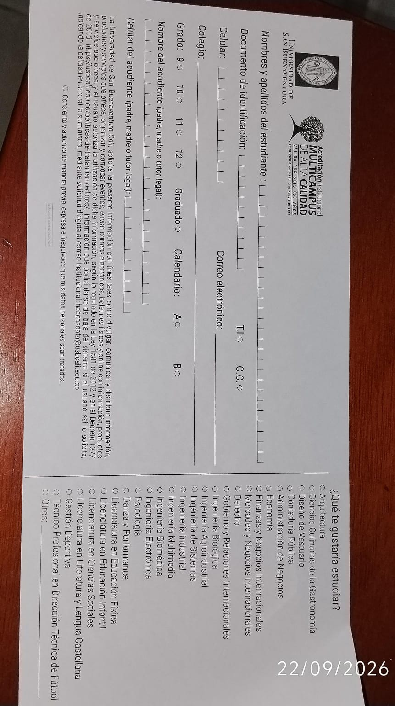
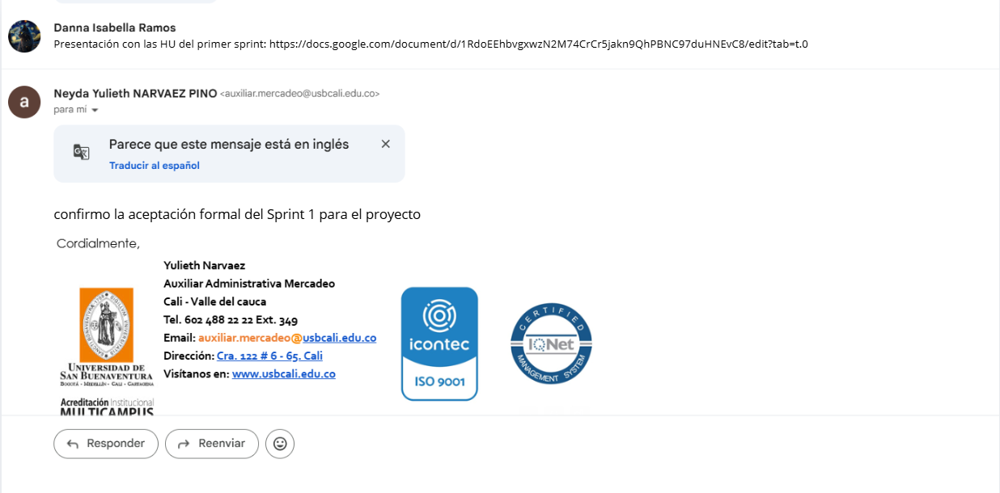

**Entrevista 1:**

**Dirigida a:** Administrador del sistema (supervisión, configuración, seguridad y cumplimiento) - Sebastián Cerezos

**Objetivo:** Definir permisos, parámetros, conexión con Salesforce, métricas y requisitos de seguridad y Habeas Data que debe cubrir la plataforma.

1. En una jornada típica de ferias o visitas a colegios, ¿cuántos formularios físicos reciben aproximadamente?

Mínimo 200

2. ¿Prefieren subir los formularios como fotos individuales tomadas con celular/tablet, o escanearlos en lote con un scanner físico?

[x] Foto individual en el momento (celular/tablet)

3. Cuando el modelo de IA tenga dudas sobre un trazo manuscrito, ¿prefieren interrumpir la carga o dejarlo marcado como "por revisar"?

[x] Seguir cargando sin detenerse (el campo queda marcado como "por revisar" y se corrige después).

4. ¿Cómo manejan la prioridad de contacto cuando un aspirante no tiene toda la información completa?

Priorizan por grado y por datos completos.

5. ¿Cuentan con una plantilla predefinida con encabezados y orden de columnas para la exportación posterior?

Se sube al CRM (Salesforce) con el formato del formulario para los aspirantes.

6. Al trabajar con Salesforce, ¿qué filtros o cruces de información usan con más frecuencia?

No es necesario (no manejan filtros/cruces relevantes desde Salesforce).

7. Al exportar los datos priorizados, ¿necesitan un archivo consolidado o archivos separados por colegio/feria?

[x] Un solo archivo consolidado.

8. Cuando un mismo aspirante queda registrado más de una vez, ¿qué debería pasar con esa información?

Eliminar el duplicado.

9. Si tuvieran que definir el éxito del proyecto en una sola métrica, ¿cuál sería?

Optimización de tiempo y reducción de errores manuales.

10. ¿Existen restricciones institucionales de seguridad o manejo de datos personales (Habeas Data) a considerar?

Evitar que la información/base de datos se administre o comparta fuera de la institución. Debe existir una capa de seguridad con proceso de validación de acceso, perfiles específicos por usuario, y trazabilidad (huella de auditoría) de quién manipula la data.

**Información adicional obtenida:**

- Se solicitó explícitamente que LexiGrid funcione como un plugin/integración directa con Salesforce, exportando la información directamente al CRM sin pasos intermedios de descarga/carga manual.
- Para la captación de formularios se habló de una app móvil que permite tomar fotos de los formularios
- se reafirmó como una necesidad el que varios usuarios puedan cargar al mismo tiempo.
- Salesforce es el sistema final de destino de los datos.

**Entrevista 2:**

**Objetivo:** Entender cómo capturan hoy los formularios en campo, qué los frena y qué necesitan de la app móvil.

Entrevistada: Dana Isabela Ramos Cargo: Embajadora

**1. ¿Cómo recibes los formularios?**

Los analistas de mercadeo entregan los formularios agrupados por feria o colegio, junto con los datos del colegio y un formulario escrito manualmente que debe transcribirse a Excel.

**2. ¿Cómo organizas los formularios antes de digitarlos?**

Prioriza los formularios con información más completa, ya que requieren más tiempo de transcripción. Deja para el final los que tienen datos faltantes, porque son más rápidos de procesar.

**3. ¿Cómo subes actualmente la información al sistema?**

Transcribo manualmente los datos en Excel utilizando la cuenta de correo de un analista.

**4. ¿Qué parte del proceso te quita más tiempo?**

Interpretar la letra de los estudiantes y transcribir números de identificación, teléfonos y correos electrónicos, debido a la dificultad para distinguir algunos caracteres.

**5. ¿Qué errores suelen ocurrir al digitar la información?**

Se pueden cometer errores al interpretar la letra o escribir los datos. Cuando la información es ilegible, debo intentar deducir lo que escribió el estudiante, lo que aumenta el riesgo de equivocaciones.

**6. ¿Cuáles son los principales problemas con los formularios?**

Muchos formularios tienen información incompleta: faltan nombres, colegios o datos de contacto. Algunos estudiantes seleccionan opciones de carreras muy diferentes entre sí o muestran poco interés y dejan campos sin diligenciar.

**7. ¿Cómo te gustaría que funcionara una herramienta para fotografiar y registrar los formularios?**

Le gustaría que la herramienta transcribiera automáticamente los datos, especialmente los numéricos, y permitiera revisar y confirmar manualmente la información que el sistema no pudiera reconocer con seguridad.

**8. ¿Qué debería pasar si una fotografía sale borrosa o tiene poca luz?**

El sistema debería identificar el problema, explicar por qué la imagen no es válida y permitir tomar otra fotografía inmediatamente.

**9. ¿Cuándo prefieres saber que una fotografía no sirve?**

En el momento de tomarla, mientras todavía tiene el formulario físico a la mano, para corregir el problema de inmediato.

**10. ¿Cómo verificas actualmente que todos los formularios quedaron registrados?**

Se guía por el orden de los formularios físicos y por las indicaciones de los analistas sobre cuáles ya fueron digitados. Sin embargo, la falta de un control claro ha ocasionado registros duplicados.

**11. ¿Qué opinas de ingresar con el correo institucional y el código estudiantil?**

Considera útil utilizar el correo institucional, pero prefiere que la contraseña pueda elegirse libremente y no tenga que ser exclusivamente el código estudiantil.

**12. ¿Qué debería hacer la herramienta cuando no haya conexión a internet?**

Debe permitir seguir tomando fotografías, conservar la información sin perderla y enviarla o sincronizarla automáticamente cuando se restablezca la conexión.

**13. ¿Qué te preocupa de manejar los formularios desde un celular?**

Le preocupa que la información personal pueda filtrarse o perderse, así como el cumplimiento de las normas de protección de datos, especialmente cuando se trata de menores de edad.

**14. ¿Qué información necesitas cuando falla la carga de una fotografía?**

Una notificación clara que indique que la carga falló y que es necesario intentar subir la fotografía nuevamente.

**Principales necesidades identificadas**

- Automatización: transcribir los datos de los formularios para reducir el trabajo manual.
- Validación de datos: permitir revisar y corregir los campos que el sistema no reconozca con certeza.
- Control de calidad de imágenes: detectar fotografías borrosas, oscuras o de baja calidad y solicitar que se repitan.
- Prevención de duplicados: llevar un registro claro de los formularios procesados y pendientes.
- Funcionamiento sin conexión: guardar temporalmente los datos y sincronizarlos al recuperar internet.
- Seguridad y privacidad: proteger la información personal y garantizar el cumplimiento de las normas de tratamiento de datos.
- Notificaciones claras: informar sobre errores de carga y ofrecer una acción para resolverlos.

**Entrevista 3:**

**Dirigida a:** Analistas de mercadeo que revisan, organizan y envían los registros. - Natalie Arce

**Objetivo:** Conocer cómo procesan hoy los formularios después de un evento y qué necesitan para revisar, organizar y enviar a Salesforce sin pasos manuales.

**1. Describe cómo procesas hoy los formularios después de un evento (digitación, Excel, correo, carga a Salesforce): ¿qué datos capturas y cuáles son los más difíciles de leer?**

Hoy los formularios se transcriben de manera manual directamente a un archivo de Excel y desde ahí se cargan al CRM (Salesforce). Los datos que se capturan son: nombre, tipo y número de documento, correo electrónico del aspirante, nombre, celular y correo electrónico del acudiente, además del programa de interés. Los datos más difíciles de leer y transcribir son el número de documento y los correos electrónicos (tanto de estudiantes como de acudientes).

**2. ¿Cuáles son los datos en los que más te demoras transcribiendo o en los que tengas que poner más cuidado?**

El número de documento y los correos electrónicos de ambos (aspirantes y acudientes), además de los números de teléfono, ya que al digitar manualmente es muy común cometer errores de dedo como duplicar un dígito o omitir algún número.

**3. ¿Qué reglas debe aplicar el sistema en algunos campos: por ejemplo que los correos contengan?**

- **Correos electrónicos:** Deben incluir obligatoriamente el carácter `@`. No se debe exigir el `.com`, ya que muchos acudientes registran correos corporativos con otros dominios.
- **Números de documento:** Deben validar la longitud exacta de dígitos según corresponda a una cédula de ciudadanía o a una tarjeta de identidad.
- **Teléfonos:** También deben validar la cantidad exacta de dígitos correspondiente a un número celular.

**4. ¿Les ha sucedido que escriben el nombre de los colegios de distintas formas? En caso de que sí, ¿cómo te gustaría que la página lo resuelva?**

Sí, sucede. Se debería resolver mediante un campo predeterminado con una lista desplegable de los colegios disponibles (filtrados por el departamento del Valle del Cauca o según la ciudad donde se realice la visita).

**5. ¿Qué hacen cuando varios estudiantes marcan casillas diferentes en campos como el calendario del colegio al que asisten? ¿Les gustaría unos campos preestablecidos relacionados con los datos del colegio?**

Muchos estudiantes dejan ese campo vacío o no saben a qué calendario pertenece su colegio, lo que genera confusión. Sí sería ideal que al seleccionar el colegio de la lista desplegable, el sistema asigne automáticamente el calendario (A o B) y demás datos asociados a esa institución.

**6. Cuando un dato queda dudoso (letra ilegible, dos casillas marcadas, celular incompleto, correo mal escrito), ¿cómo lo resuelves y qué necesitas tener a la vista para decidir?**

Primero intentamos contactar al estudiante por llamada o WhatsApp para confirmar la información. Sin embargo, muchas veces no contestan y nos toca deducir ("adivinar") el dato basándonos en lo que se alcanza a leer en el formulario.

**7. ¿Cuándo confías en un dato extraído por la IA y qué casos dudosos esperas que el sistema detecte?**

Se espera que el sistema detecte posibles errores o baja legibilidad especialmente en el número de documento, los correos electrónicos, el nombre completo y los datos de contacto del acudiente.

**8. ¿Te gustaría que se manejen etiquetas como “por revisar” o “pendiente” cuando la IA no quede con el 100% de certeza?**

Sí, sería ideal que cuando la IA no tenga el 100 % de certeza, el registro quede marcado con etiquetas como *"por revisar"* o *"pendiente"* para que un analista realice la verificación manual.

**9. ¿Cómo te gustaría organizar la revisión hecha por la IA (por colegio, por jornada, pendientes) y qué pasa si dos personas corrigen el mismo formulario?**

La revisión debe organizarse por **colegio**, ya que así es como se gestionan normalmente los formularios. *(Nota: En la entrevista no se mencionó qué ocurre si dos personas corrigen simultáneamente el mismo formulario).*

**10. ¿Cómo detectas hoy a los aspirantes repetidos y qué criterio usas para decidir cuál registro se queda? Si se descarta uno por error, ¿cómo lo recuperarías?**

Los repetidos suelen aparecer porque se visita el mismo colegio en distintos años y un estudiante que llenó el formulario en décimo vuelve a llenarlo en once. Actualmente, el CRM alerta sobre el duplicado y solo actualizamos el grado. En el nuevo aplicativo, el criterio debe ser conservar siempre la **información más reciente** para mantener los datos actualizados. *(Nota: No se especificó cómo recuperar un registro descartado por error).*

**11. ¿Y si el celular del aspirante y el del acudiente son iguales?**

Se deja un solo número, pero el criterio depende del tipo de evento:

- **Visitas a colegios:** Se prioriza dejar el número como contacto del **estudiante**, ya que es el interesado principal.
- **Ferias o eventos institucionales (como *Full Day*):** Como el acudiente suele asistir presencialmente con el estudiante, se prioriza registrar ese número como contacto del **acudiente**.

**12. ¿Qué haces con los aspirantes que no dejaron celular ni correo? ¿Cómo debe tratarse al enviarlos a Salesforce?**

Aunque durante el evento se procura revisar que nadie entregue el formulario incompleto, si a algún estudiante se le pasa y no deja ningún dato de contacto (ni celular propio, ni del acudiente, ni correo), el registro se **descarta** por completo porque no hay forma de contactarlo.

**13. ¿Con qué criterios decide el equipo comercial a quién llamar primero (grado, carrera, datos completos)?**

El criterio principal es tener los **datos de contacto completos** y la inmediatez: se contacta a la persona tan pronto llega la información, sin importar el colegio, el calendario, el grado o si ya es graduado. Tampoco importa si eligió una o varias carreras (el CRM tiene un campo para el programa de mayor interés y otro para "otros programas" de interés futuro, incluyendo carreras que la universidad aún no oferta), siempre se les da prioridad de contacto por igual.

**14. ¿Cómo registras los colegios y organizas una feria o visita? ¿Los eventos tienen fecha?**

*(Nota: Este punto no fue abordado durante la entrevista).*

**15. Al enviar a Salesforce: ¿qué querrías ver antes de enviar, qué debería pasar si algunos registros fallan o Salesforce no responde, y cómo corregirías un dato que ya se envió?**

Hoy en día, si un dato no cumple con las reglas (por ejemplo, un documento que no tiene los diez dígitos completos), Salesforce arroja un error y obliga a corregirlo manualmente antes de permitir la carga. *(Nota: No se profundizó en qué visualizar antes del envío, cómo manejar caídas del sistema o cómo editar registros ya enviados).*

**16. Para ingresar a la plataforma usarías correo y contraseña: ¿qué debería pasar si olvidas la clave o dejas el computador abierto?**

El acceso para el equipo encargado de las correcciones debe ser mediante usuario (correo electrónico) y contraseña (asignada por la plataforma o creada por el usuario).

[Entrevista del administrador: https://drive.google.com/file/d/1I3Kr_vajBmk_emgBtmO8NubbiLqrlIru/view?usp=sharing](https://drive.google.com/file/d/1I3Kr_vajBmk_emgBtmO8NubbiLqrlIru/view?usp=sharing)

Entrevista del analista: [https://drive.google.com/file/d/1HAYflZE3PSuhdEMJaAoeLudbZK69N5VH/view?usp=sharing](https://drive.google.com/file/d/1HAYflZE3PSuhdEMJaAoeLudbZK69N5VH/view?usp=sharing)

Entrevista del embajador:

[https://drive.google.com/file/d/1iWT3Y6CxMyRxMOCUhvTGk7clwr0paMME/view?usp=sharing](https://drive.google.com/file/d/1iWT3Y6CxMyRxMOCUhvTGk7clwr0paMME/view?usp=sharing)

**Prototipado:**

Propuesta de prototipo a partir de la elicitación:
[https://uxpilot.ai/s/3b7b780cb3f410b8ea91f95f0009a2fc](https://uxpilot.ai/s/3b7b780cb3f410b8ea91f95f0009a2fc)

Tester: Yulieth Cardona, Líder de los embajadores y analista

**Observaciones hechas por el tester:**

Para perfil del embajador:

- recordar que el perfil que va a usar el embajador para la app será una brindado por mercadeo y/o será el de alguien de mercadeo
- A la hora de tomar foto interesa que el embajador pueda ver si estas fueron procesadas correctamente
- Que haya la opción de retomar la foto si el embajador no está segura de la calidad de esta
- Que quede claro si una foto marcada como dudosa por calidad debe repetirse ahí mismo o si puede seguir subiendo y corregirla después.
- Que se pueda ver en algún lugar de la app cuántos formularios lleva cargados en la jornada.
- Es preferible la vista dividida tipo imagen vs texto editable.

Para perfil del analista:

- Que la exportación en salesforce sea según la jornada/evento
- Que se pueda filtrar para no ver los aspirantes incontactables
- Que se muestre una confirmación antes de enviar los registros a Salesforce, indicando cuántos se van a enviar.
- Que se pueda saber por qué un registro quedó eliminado como duplicado (qué datos coincidieron).
- Que el historial permite buscar directamente por un aspirante, no sólo por usuario.

Prueba del formato de inscripción:

Prueba de la validación con el cliente:

